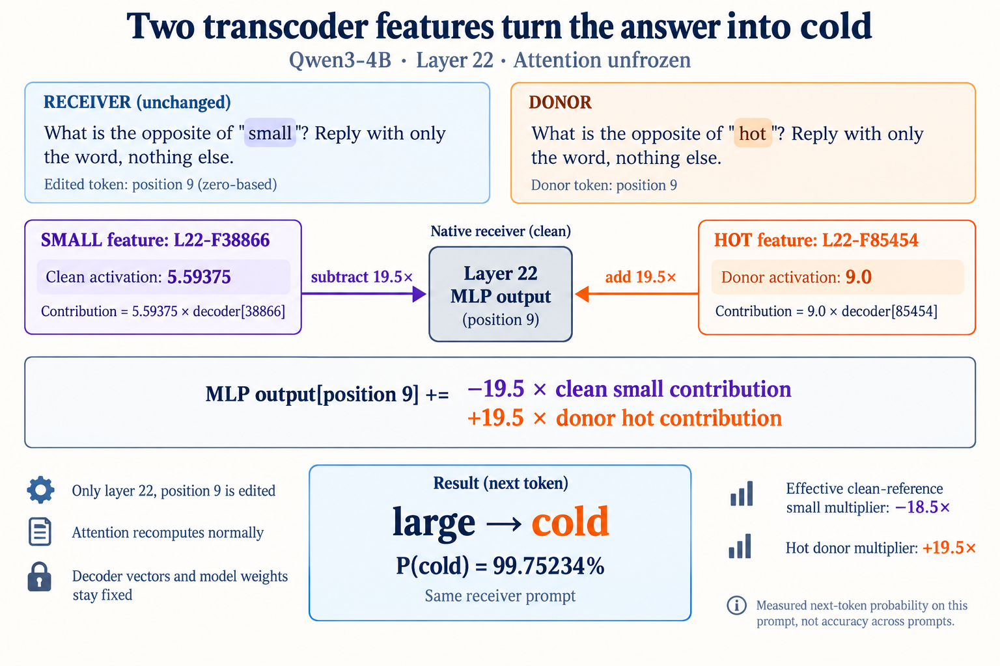
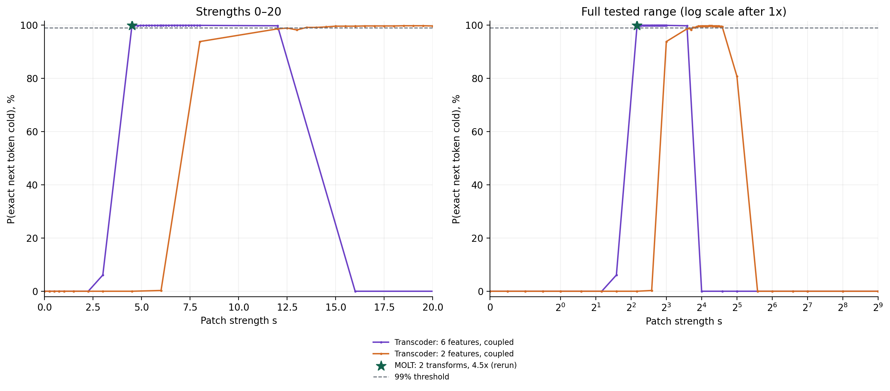

# Single-layer transcoder strength search — 11 October 2026

**Layer 22 transcoders exceed 99% P(exact next token `cold`) with attention unfrozen.** The original executed run contains 463 trials across 14 feature groups, including controls, peak refinements, and held-out wording. [Raw results](../../results/2026-10-11-layer22-transcoder/artifacts/results.json), [tensor audit](../../results/2026-10-11-layer22-transcoder/artifacts/verification.json), and [interactive report](https://small-hot-molt-experiment.rakaar.chatgpt.site/layer22-transcoder/) document the run.



Receiver: `What is the opposite of "small"? Reply with only the word, nothing else.`

Donor: `What is the opposite of "hot"? Reply with only the word, nothing else.`

Only the native layer-22 MLP output at the receiver's `small` token, position 9, receives an additive delta. All indices are zero-based. The next-token readout is position 28. Attention, normalization, and native MLPs recompute normally; model weights are unchanged.

| Recipe | Small feature IDs, layer 22 | Hot feature IDs, layer 22 | Strength | P(cold) |
|---|---|---|---:|---:|
| Pair, first sampled crossing | 38866 | 85454 | 13.5 | 99.14160% |
| Pair, highest measured | 38866 | 85454 | 19.5 | 99.75234% |
| Six features | 38866, 42644, 113890 | 85454, 122802, 154689 | 4.5 | 99.80232% |
| Six features, highest measured | 38866, 42644, 113890 | 85454, 122802, 154689 | 6.1041665 | 99.92866% |
| MOLT control rerun | 2339 | 941 | 4.5 | 99.82693% |

Transcoder contribution = scalar activation × fixed decoder vector. For the pair, clean small activation is 5.59375 and donor small activation is zero; clean hot activation is zero and donor hot activation is 9.0:

```text
delta = −s × 5.59375 × decoder[L22-F38866]
        +s × 9.0 × decoder[L22-F85454]
MLP output[position 9] += delta
```

At s = 19.5, the conceptual clean-reference small multiplier is −18.5, and the hot donor multiplier is +19.5. This is an output contribution edit, not multiplication of an input vector or a clamp on a re-encoded live activation. The MOLT control transfers full gate × low-rank output contributions; it does not merely patch a scalar gate.



The prespecified coarse strengths span 0–512, with local refinements around three measured peaks. Three small and three hot candidates had eligible activation differences; candidates and groups were saved before measuring manipulated probabilities. Higher strength can reduce success. The selected 13.5 pair also produces `cold` or `Cold.` on four held-out wording variants, but their exact lowercase-token probabilities do not remain above 99%. This is a preliminary one-prompt strength search, not broad accuracy or a global minimum-feature proof.

## Reproduce

Use Python 3.12, a compatible CUDA-enabled PyTorch build, and a GPU with 24 GB VRAM. The recorded run used an RTX 3090, PyTorch `2.11.0+cu128`, and Transformers `4.57.6`.

From the repository root:

```sh
python3 -m pip install -r experiments/layer22-transcoder/requirements.txt
python3 experiments/layer22-transcoder/rebuild_assets.py
python3 experiments/layer22-transcoder/prepare.py
python3 experiments/layer22-transcoder/run.py
python3 experiments/layer22-transcoder/verify.py
```

`rebuild_assets.py` regenerates selected transcoder rows and MOLT layer-22 tensors from the pinned public weights, and checks the original asset hashes. It imports the previous experiment's weight-preparation functions but does not call its inference runner. `prepare.py` downloads the pinned base model and full 163,840-feature transcoder layer 22, verifying Hub sizes and LFS hashes. Checkpoints, private cloud credentials, SSH records, and provider logs are not committed.

The original `bootstrap.sh` retains the Vast container layout. The scientific runner and audit are unchanged from the executed GPU code; the new packaging helper has not been exercised as part of a fresh GPU rerun. Saved runtime and checkpoint revisions are in the results and protocol JSON.

The report builder accepts a dated results directory with `artifacts/results.json`, `artifacts/verification.json`, and `cleanup.json`:

```sh
python3 experiments/layer22-transcoder/report.py results/2026-10-11-layer22-transcoder
```

The report's relative evidence links are arranged by the original website packager; the published report is the complete linked version. Both dates' full tensor captures remain backed up locally and downloadable from that report. Git contains compact results/audit records and the figure rather than the large binary captures. The original GPU was destroyed after hash-verified backup.
