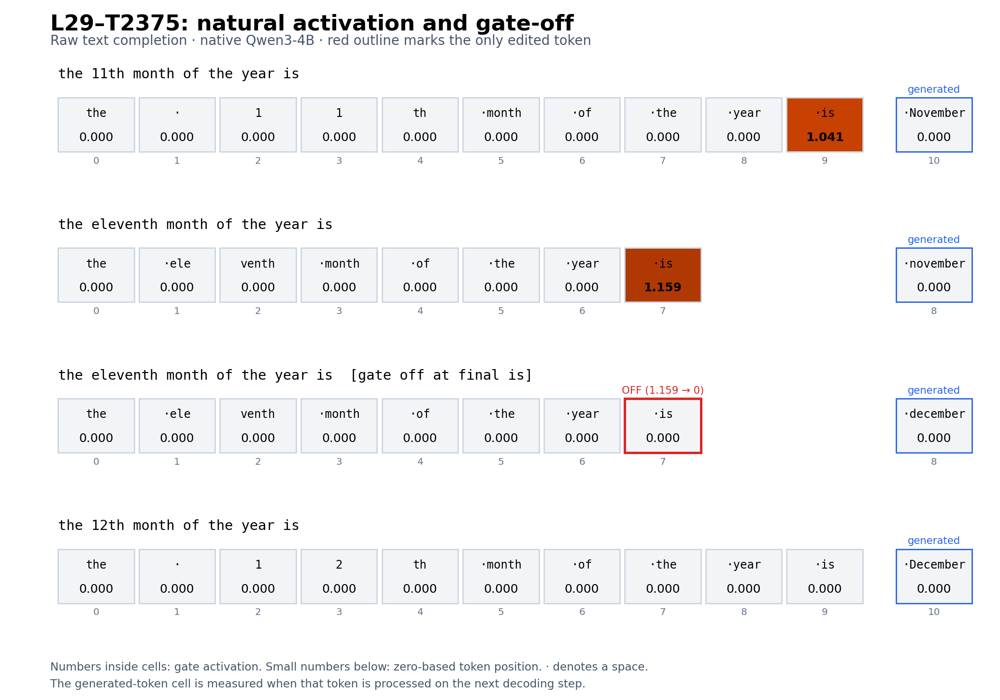

# L29-T2375 month prompts: natural activation and one-token gate-off

Recorded 2 November 2026. Native Qwen3-4B, raw prefixes, greedy decoding, 32 generated-token cap. The first three observations left all contributions unchanged. The follow-up below removes one selected MOLT contribution at one input position.

| Prompt | Initial answer | Nonzero input gate |
|---|---|---|
| `the 11th month of the year is` | November | position 9, ` is`, 1.041148 |
| `the eleventh month of the year is` | november | position 7, ` is`, 1.158554 |
| `the 12th month of the year is` | December | None |

All other input gates are exactly zero. The first generated answer token also has zero activation when processed on the next decoding step. A leading space is part of tokens shown as ` is`.

The observation hook only reads the residual before L29 post-attention normalization. Unobserved and observed runs have identical output token IDs and full-vocabulary logit hashes at all 32 decoding steps for all three prompts. The historical spelled-out reference reproduced its token IDs, with maximum selected-probability error 5.96e-8.

An independent local CPU audit reconstructed standardization, raw gate preactivation and thresholded activation from saved residuals and pinned feature weights. Maximum gate error was below 0.000001.

The initial month answers are correct; the full raw continuations repeat and hit the 32-token cap. These observations localize activity on these prompts; they do not establish a general ordinal computation.

Raw responses, residual vectors, runtime identity, source hashes and selected weights are in the hash-verified private local backup. Public base model files and the runtime environment are reproducible from pinned manifests and are excluded from that archive.

## One-token gate-off follow-up

Exact raw prompt: `the eleventh month of the year is`. Native initial answer: ` november`. With L29-T2375 off only at input position 7 (` is`), the initial answer becomes ` december`. The natural gate at that position was 1.1585536003 and the replacement value is zero.

The edit subtracts the selected MOLT contribution from the native MLP output, using FP32 arithmetic and one BF16 cast. Other MLP output positions are not directly edited; zero generated positions are edited. The only nonzero local intervention is at input position 7. Later model computations can respond to that edit.

A fresh native run and zero-strength control matched exactly. The recent native reference reproduced its output IDs, with maximum selected-probability error below 0.000001. The CPU audit passed encoder, operator, mask, subtraction and BF16-rounding checks over eight saved vector files and ten sampled positions. These samples start from saved standardized residuals; they do not independently reproduce the full model forward pass.

Full native continuation (32-token cap):

> november. the twelfth month is december. the first month is january. the second month is february. the third month is march. the fourth month

Full gate-off continuation (32-token cap):

> december. the twelfth month is january. the tenth month is september. the ninth month is august. the eighth month is july. the seventh month

The displayed effect concerns the initial answer. The longer raw continuation still drifts. No additional prompt families or intervention positions were tested in this follow-up. All 22 remote research files were downloaded and hash-verified locally.

## Three-part vocabulary readout

The native L29 MLP output, removed L29-T2375 contribution, and actual BF16 remainder were each projected through the same output matrix and frozen native final RMSNorm. The capitalized November token ranks first before subtraction; the capitalized December token ranks first afterward. This is a direct vocabulary readout, separate from full-model generation probabilities.

[Readout figure, complete vocabulary scores, and audit](../2026-11-02-eleven-contribution-readout/README.md).

## Alphabet and Roman-numeral readout figures

[Two further figures and audited vocabulary exports](../2026-11-02-eleven-crossdomain-readouts/README.md) apply the same shared-normalization, three-part readout to the exact successful alphabet and Roman-numeral prompts.
