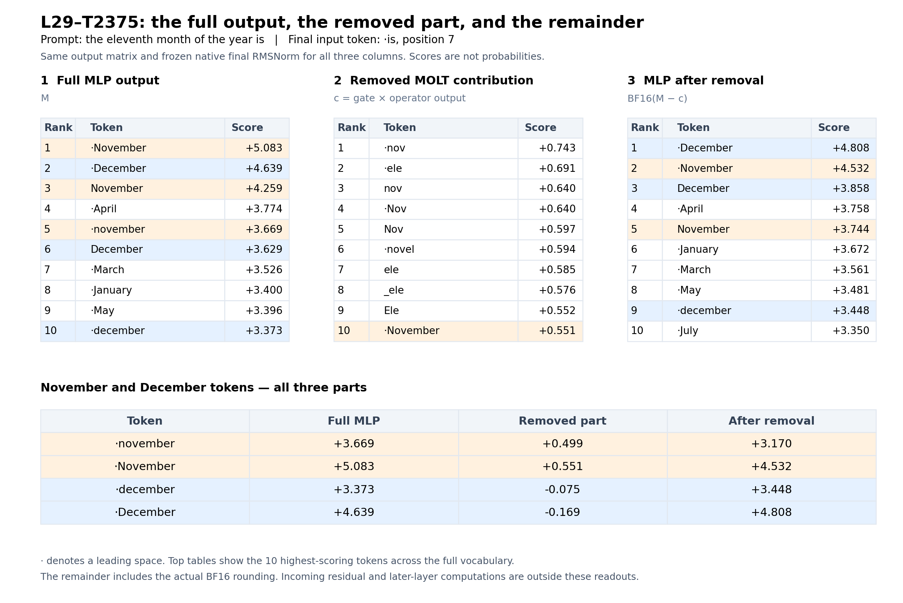

# Three-part L29 MLP vocabulary readout

Exact raw prompt: `the eleventh month of the year is`; final input position 7, token ` is`.

The three primary vectors are native L29 MLP output M, positive intended L29-T2375 contribution c, and the actual edited output BF16(M - c). The removed vector c is shown with its original positive sign; the intervention was -c.

Every vector uses the same native final normalization: `W_out @ (gamma * vector / sqrt(mean(native_final_residual^2) + epsilon))`. The scalar denominator is derived from the whole native residual after layer 35, at the same token. The learned final RMSNorm gamma is included. No vector is independently normalized.

These are direct vocabulary scores, not probabilities or complete-model answers. They omit the incoming residual contribution and the computations in later layers.

| Token | Full MLP | Removed MOLT | After removal |
|---|---:|---:|---:|
| `·november` | +3.669039 | +0.499219 | +3.169827 |
| `·November` | +5.082721 | +0.550551 | +4.531908 |
| `·december` | +3.372773 | -0.074867 | +3.448360 |
| `·December` | +4.639205 | -0.168550 | +4.807706 |

The capitalized November token ranks first in the full MLP readout; the capitalized December token ranks first after subtraction. The removed contribution favors November and mildly disfavors December in this context. Its highest-scoring tokens also include fragments such as ` nov`, ` ele` and ` novel`; this does not establish a general numerical operation.

For lowercase tokens, the direct MLP November-minus-December margin changes from +0.296265 to -0.278533. The actual complete-model margin changes from +1.125000 to -2.000000. The direct readout matches the direction of the effect, but is not a quantitative explanation of the whole forward-pass change. Downstream computation and normalization changes remain to be separated.

The ideal FP32 decomposition is additive to within 0.00000095 over the full vocabulary. The actual BF16 remainder differs from the ideal remainder, with maximum vocabulary-score difference 0.00330107. The primary display uses the actual BF16 remainder.

The native MLP vector and native final RMSNorm output reproduced exactly. CPU auditing checked 126 saved output-matrix rows, including the highest and lowest tokens for all parts and the four target tokens. All passed. The full 151,936-row readouts are retained in the verified array archive and exported CSV.

[All vocabulary scores and ranks](all-vocabulary-scores.csv) · [Target-token scores](target-token-scores.csv) · [Audit](audit.json)

The CSV tokenizer_piece field preserves raw tokenizer vocabulary strings; unmapped output rows are labeled explicitly. All ranks are competition ranks, with ties assigned the same rank.

## 1  Full MLP output

| Rank | Token | Score |
|---:|---|---:|
| 1 | `·November` | +5.082721 |
| 2 | `·December` | +4.639205 |
| 3 | `November` | +4.259282 |
| 4 | `·April` | +3.774039 |
| 5 | `·november` | +3.669039 |
| 6 | `December` | +3.629280 |
| 7 | `·March` | +3.525506 |
| 8 | `·January` | +3.399559 |
| 9 | `·May` | +3.395536 |
| 10 | `·december` | +3.372773 |
| 11 | `·October` | +3.302915 |
| 12 | `·July` | +3.210929 |
| 13 | `·September` | +3.196511 |
| 14 | `·February` | +3.193693 |
| 15 | `·June` | +3.134406 |
| 16 | `五月` | +3.048327 |
| 17 | `·August` | +3.027000 |
| 18 | `·ноя` | +2.937041 |
| 19 | `·Nov` | +2.895029 |
| 20 | `April` | +2.813153 |
| 21 | `十月` | +2.789181 |
| 22 | `May` | +2.695022 |
| 23 | `·novembre` | +2.639594 |
| 24 | `March` | +2.636927 |
| 25 | `·nov` | +2.616362 |
| 26 | `十一` | +2.606900 |
| 27 | `January` | +2.573559 |
| 28 | `·ноября` | +2.569403 |
| 29 | `October` | +2.558687 |
| 30 | `July` | +2.542009 |

## 2  Removed MOLT contribution

| Rank | Token | Score |
|---:|---|---:|
| 1 | `·nov` | +0.742511 |
| 2 | `·ele` | +0.691156 |
| 3 | `nov` | +0.640028 |
| 4 | `·Nov` | +0.639505 |
| 5 | `Nov` | +0.596964 |
| 6 | `·novel` | +0.594290 |
| 7 | `ele` | +0.584747 |
| 8 | `_ele` | +0.576324 |
| 9 | `Ele` | +0.551916 |
| 10 | `·November` | +0.550551 |
| 11 | `·Ele` | +0.542948 |
| 12 | `-Nov` | +0.537568 |
| 13 | `·Novel` | +0.522335 |
| 14 | `十一` | +0.521061 |
| 15 | `November` | +0.514637 |
| 16 | `·november` | +0.499219 |
| 17 | `(ele` | +0.497483 |
| 18 | `illi` | +0.465692 |
| 19 | `lli` | +0.459350 |
| 20 | `·novembre` | +0.440553 |
| 21 | `XI` | +0.438380 |
| 22 | `·ноября` | +0.434822 |
| 23 | `·novels` | +0.431392 |
| 24 | `eli` | +0.427453 |
| 25 | `新型` | +0.424429 |
| 26 | `·نوفمبر` | +0.419250 |
| 27 | `·EI` | +0.416309 |
| 28 | `·XI` | +0.413949 |
| 29 | `小说` | +0.404881 |
| 30 | `·Elli` | +0.393435 |

## 3  MLP after removal

| Rank | Token | Score |
|---:|---|---:|
| 1 | `·December` | +4.807706 |
| 2 | `·November` | +4.531908 |
| 3 | `December` | +3.857619 |
| 4 | `·April` | +3.758133 |
| 5 | `November` | +3.744246 |
| 6 | `·January` | +3.671879 |
| 7 | `·March` | +3.561108 |
| 8 | `·May` | +3.481485 |
| 9 | `·december` | +3.448360 |
| 10 | `·July` | +3.350027 |
| 11 | `·February` | +3.334958 |
| 12 | `·September` | +3.280079 |
| 13 | `·June` | +3.224825 |
| 14 | `·October` | +3.173063 |
| 15 | `·november` | +3.169827 |
| 16 | `·August` | +3.086680 |
| 17 | `五月` | +2.957999 |
| 18 | `January` | +2.894396 |
| 19 | `April` | +2.865243 |
| 20 | `May` | +2.756820 |
| 21 | `March` | +2.719562 |
| 22 | `July` | +2.642758 |
| 23 | `·ноя` | +2.599064 |
| 24 | `十月` | +2.576583 |
| 25 | `·Dec` | +2.508706 |
| 26 | `June` | +2.493955 |
| 27 | `February` | +2.482174 |
| 28 | `September` | +2.460949 |
| 29 | `October` | +2.451565 |
| 30 | `·april` | +2.384877 |

## Lowest-scoring tokens for the removed contribution

| Token | Score |
|---|---:|
| `·thirteen` | -0.450259 |
| `esan` | -0.417456 |
| `cce` | -0.402862 |
| `特朗` | -0.400733 |
| `xz` | -0.390376 |
| `_SENS` | -0.385524 |
| `ISO` | -0.382415 |
| `パー�` | -0.381185 |
| `(keys` | -0.378583 |
| `·qw` | -0.378244 |
| `除夕` | -0.376387 |
| `谟` | -0.375002 |
| `gow` | -0.374551 |
| `·bz` | -0.370918 |
| `·Saturdays` | -0.370069 |
| `anos` | -0.368760 |
| `筏` | -0.367638 |
| `�` | -0.367303 |
| `加盖` | -0.364953 |
| `Rails` | -0.350620 |
| `·LZ` | -0.349793 |
| `CCA` | -0.348846 |
| `erable` | -0.347345 |
| `黯` | -0.346035 |
| `正版` | -0.344340 |
| `·ISO` | -0.343691 |
| `ду` | -0.343461 |
| `七大` | -0.339632 |
| `·gag` | -0.337490 |
| `hev` | -0.337449 |
