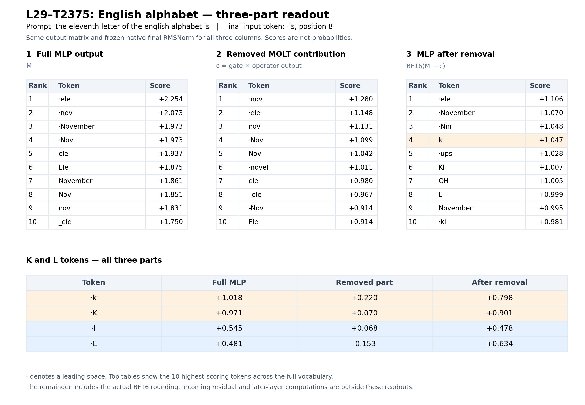
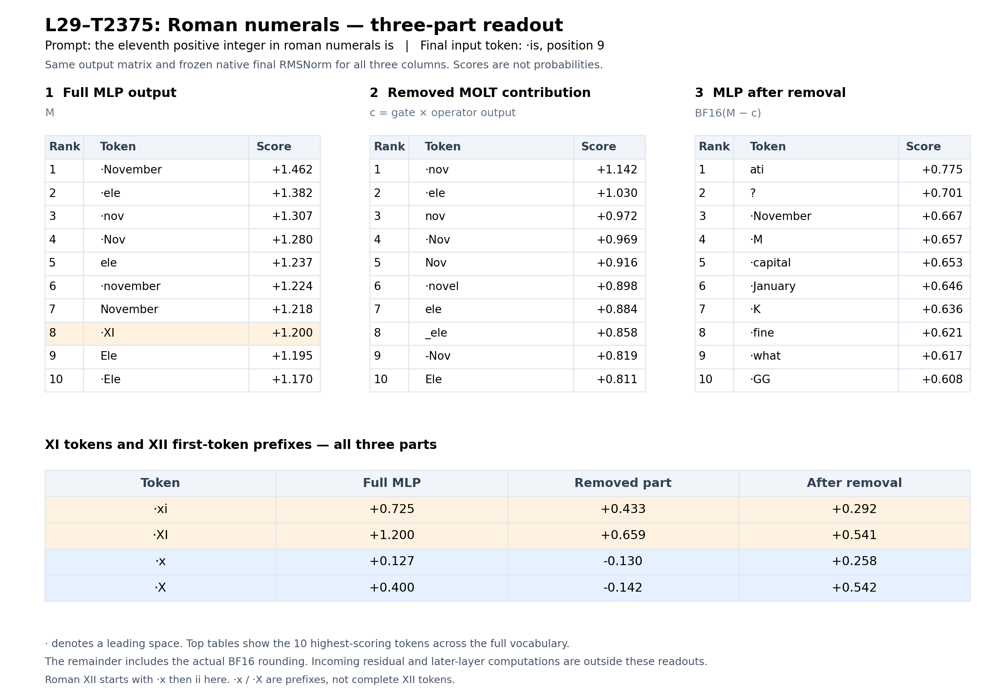

# Alphabet and Roman-numeral three-part readouts

Two separate figures use the same method and layout as the month analysis. Each prompt has its own native final RMSNorm scalar, shared across its three vectors, and the same learned RMSNorm weights and output matrix. The vectors are the full native L29 MLP output, the removed L29-T2375 contribution, and the actual BF16 remainder.

These are direct vector readouts; top-ranked table tokens are not generated responses. This analysis adds one new native prefill per prompt to reproduce the original MLP vectors exactly and obtain each prompt’s normalization scale. Gate-off vectors and generation records come from the previously audited raw-prefix study.

| Prompt family | Lowercase contrast | Full MLP margin | After-removal margin |
|---|---|---:|---:|
| English alphabet | ` k` versus ` l` | +0.472253 | +0.319777 |
| Roman numerals | ` xi` versus ` x` | +0.598332 | +0.034353 |

For the alphabet, the isolated remainder still favors k over l. For Roman numerals, the lowercase xi advantage over the x prefix nearly disappears but remains positive. The uppercase XI/X pair changes order by a small amount. These readouts weaken the eleventh-answer preference without fully reproducing the complete model’s initial-answer changes.

The removed contribution’s highest-scoring tokens include nov/ele fragments in both prompts, despite their different answer domains. This is a prompt-specific observation, not a general semantic label for the transform.

## English alphabet

[Alphabet report and complete vocabulary scores](alphabet/README.md)

## Roman numerals

[Roman report and complete vocabulary scores](roman/README.md)

XII is multi-token in the recorded continuation: ` x` followed by `ii`. The figure’s x/X rows are shared first-token prefixes, not complete XII tokens.

Both CPU audits passed, all 151,936 CSV rows per case were checked against the saved arrays, and the remote research files were downloaded and hash-verified.

## Original contribution cosine matrix

[Three-by-three cosine matrix and gate/operator/contribution magnitudes](../2026-11-03-eleven-contribution-similarity/README.md) compare the original native-space contributions before final RMSNorm or vocabulary projection.
