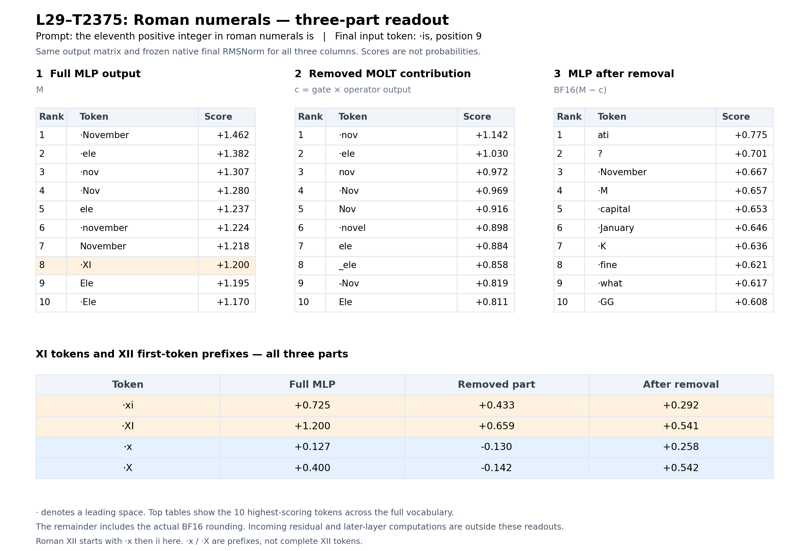

# Roman numerals: three-part L29 MLP readout

Exact raw prompt: `the eleventh positive integer in roman numerals is`; final input position 9, token ` is`.

The three primary vectors are native L29 MLP output M, positive intended L29-T2375 contribution c, and the actual edited output BF16(M - c). The contribution is displayed with its original positive sign; the gate-off intervention subtracts it.

All three use `W_out @ (gamma * vector / sqrt(mean(native_final_residual^2) + epsilon))`. The denominator comes from the whole native final residual for this prompt, after layer 35 at the same position. Learned final RMSNorm gamma is included. The three vectors share that scale and are not independently normalized.

These are direct vocabulary scores, not probabilities or complete-model answers. Incoming residual and later-layer computations are excluded from these three MLP-part projections.

XII is multi-token here: the gate-off response starts with the tokens ` x` and `ii`. The x/X rows are first-token prefixes, not complete XII answers.

| Token | Full MLP | Removed MOLT | After removal |
|---|---:|---:|---:|
| <code>·xi</code> | +0.725391 | +0.433409 | +0.291964 |
| <code>·XI</code> | +1.200244 | +0.658983 | +0.541406 |
| <code>·x</code> | +0.127059 | -0.130247 | +0.257611 |
| <code>·X</code> | +0.400247 | -0.141820 | +0.541964 |

The highest full-MLP readout token is <code>·November</code>; the highest remainder token is <code>ati</code>.

For the displayed contrast <code>·xi</code> versus <code>·x</code>, the direct margin changes from +0.598332 to +0.034353. The saved complete-model first-token margin changes from +0.875000 to -1.750000. This first-token comparison does not give complete-answer probabilities.

The native MLP vector reproduced exactly on the new forward pass, and the native final RMSNorm output reconstructed exactly. CPU auditing passed over 132 saved output-matrix rows, including the highest and lowest tokens for every part and all target tokens.

The ideal FP32 decomposition is additive to within 0.00000036 over the full vocabulary. The primary display uses the actual BF16 remainder. Its maximum score difference from ideal M-minus-c is 0.00161195.

The direct readout is a diagnostic of these saved vectors. It does not by itself explain the full generated-answer change or establish a general add-one mechanism.

[All vocabulary scores and ranks](all-vocabulary-scores.csv) · [Target scores](target-token-scores.csv) · [CPU audit](audit.json)

The CSV preserves raw tokenizer-piece strings and explicitly labels unmapped output rows. Ranks use competition ranking, so exact ties share a rank.

## Recorded native continuation

> xi, but the eleventh letter of the alphabet is k. So, the answer is k. But wait, the question is about the eleventh positive integer

## Recorded final-input-only gate-off continuation

> xii, but the eleventh letter of the alphabet is k. So, the eleventh positive integer is xii, but the eleventh letter is k

These historical continuations hit the 32-token cap and can drift. This readout analysis adds a fresh native prefill to reproduce the vectors and obtain the contextual normalization scale; it does not rerun generation or gate-off inference.

## 1  Full MLP output

| Rank | Token | Score |
|---:|---|---:|
| 1 | <code>·November</code> | +1.462047 |
| 2 | <code>·ele</code> | +1.382491 |
| 3 | <code>·nov</code> | +1.306946 |
| 4 | <code>·Nov</code> | +1.280360 |
| 5 | <code>ele</code> | +1.237414 |
| 6 | <code>·november</code> | +1.224263 |
| 7 | <code>November</code> | +1.217908 |
| 8 | <code>·XI</code> | +1.200244 |
| 9 | <code>Ele</code> | +1.195362 |
| 10 | <code>·Ele</code> | +1.169637 |
| 11 | <code>XI</code> | +1.168226 |
| 12 | <code>十一</code> | +1.152088 |
| 13 | <code>·novel</code> | +1.145606 |
| 14 | <code>Nov</code> | +1.143499 |
| 15 | <code>nov</code> | +1.108659 |
| 16 | <code>-Nov</code> | +1.097600 |
| 17 | <code>ati</code> | +1.044051 |
| 18 | <code>·Novel</code> | +1.040217 |
| 19 | <code>·eleven</code> | +1.036547 |
| 20 | <code>·ноя</code> | +0.984186 |
| 21 | <code>_ele</code> | +0.974330 |
| 22 | <code>NI</code> | +0.929781 |
| 23 | <code>·ноября</code> | +0.927770 |
| 24 | <code>(ele</code> | +0.916249 |
| 25 | <code>·eligible</code> | +0.841180 |
| 26 | <code>·�</code> | +0.840498 |
| 27 | <code>?</code> | +0.840019 |
| 28 | <code>halb</code> | +0.833062 |
| 29 | <code>·EI</code> | +0.794007 |
| 30 | <code>atori</code> | +0.780111 |

## 2  Removed MOLT contribution

| Rank | Token | Score |
|---:|---|---:|
| 1 | <code>·nov</code> | +1.142051 |
| 2 | <code>·ele</code> | +1.030377 |
| 3 | <code>nov</code> | +0.972005 |
| 4 | <code>·Nov</code> | +0.968644 |
| 5 | <code>Nov</code> | +0.916271 |
| 6 | <code>·novel</code> | +0.898449 |
| 7 | <code>ele</code> | +0.883598 |
| 8 | <code>_ele</code> | +0.857863 |
| 9 | <code>-Nov</code> | +0.818684 |
| 10 | <code>Ele</code> | +0.810965 |
| 11 | <code>·November</code> | +0.795227 |
| 12 | <code>·Novel</code> | +0.791120 |
| 13 | <code>·Ele</code> | +0.771141 |
| 14 | <code>November</code> | +0.754355 |
| 15 | <code>(ele</code> | +0.746863 |
| 16 | <code>十一</code> | +0.746148 |
| 17 | <code>·november</code> | +0.746021 |
| 18 | <code>illi</code> | +0.700232 |
| 19 | <code>lli</code> | +0.683187 |
| 20 | <code>·XI</code> | +0.658983 |
| 21 | <code>XI</code> | +0.654031 |
| 22 | <code>eli</code> | +0.649950 |
| 23 | <code>新型</code> | +0.648700 |
| 24 | <code>·ноября</code> | +0.648474 |
| 25 | <code>·novels</code> | +0.643053 |
| 26 | <code>·novembre</code> | +0.641132 |
| 27 | <code>·نوفمبر</code> | +0.631599 |
| 28 | <code>·EI</code> | +0.622510 |
| 29 | <code>小说</code> | +0.593054 |
| 30 | <code>·Ellison</code> | +0.592913 |

## 3  MLP after removal

| Rank | Token | Score |
|---:|---|---:|
| 1 | <code>ati</code> | +0.775289 |
| 2 | <code>?</code> | +0.700832 |
| 3 | <code>·November</code> | +0.666985 |
| 4 | <code>·M</code> | +0.657155 |
| 5 | <code>·capital</code> | +0.652697 |
| 6 | <code>·January</code> | +0.646164 |
| 7 | <code>·K</code> | +0.636348 |
| 8 | <code>·fine</code> | +0.620896 |
| 9 | <code>·what</code> | +0.616559 |
| 10 | <code>·GG</code> | +0.607665 |
| 11 | <code>·cross</code> | +0.593415 |
| 12 | <code>·One</code> | +0.589739 |
| 13 | <code>·Hamilton</code> | +0.588909 |
| 14 | <code>·tor</code> | +0.588552 |
| 15 | <code>·Cont</code> | +0.578506 |
| 16 | <code>·Help</code> | +0.578126 |
| 17 | <code>·one</code> | +0.571012 |
| 18 | <code>·December</code> | +0.563817 |
| 19 | <code>·What</code> | +0.559657 |
| 20 | <code>1</code> | +0.545782 |
| 21 | <code>·Monument</code> | +0.542862 |
| 22 | <code>·stor</code> | +0.542448 |
| 23 | <code>·X</code> | +0.541964 |
| 24 | <code>·XI</code> | +0.541406 |
| 25 | <code>·eligible</code> | +0.538664 |
| 26 | <code>-capital</code> | +0.536935 |
| 27 | <code>tor</code> | +0.534525 |
| 28 | <code>·J</code> | +0.532035 |
| 29 | <code>·Recall</code> | +0.522767 |
| 30 | <code>·Y</code> | +0.522106 |

## Lowest-scoring tokens for the removed contribution

| Token | Score |
|---|---:|
| <code>·thirteen</code> | -0.720563 |
| <code>特朗</code> | -0.652275 |
| <code>xz</code> | -0.627859 |
| <code>·bz</code> | -0.606441 |
| <code>esan</code> | -0.605277 |
| <code>(keys</code> | -0.602873 |
| <code>cce</code> | -0.596200 |
| <code>パー�</code> | -0.583040 |
| <code>·Saturdays</code> | -0.577708 |
| <code>gow</code> | -0.575301 |
| <code>_SENS</code> | -0.571052 |
| <code>筏</code> | -0.569777 |
| <code>·LZ</code> | -0.566906 |
| <code>谟</code> | -0.566752 |
| <code>ду</code> | -0.562494 |
| <code>�</code> | -0.561389 |
| <code>CCA</code> | -0.559879 |
| <code>·qw</code> | -0.555652 |
| <code>anos</code> | -0.555495 |
| <code>ISO</code> | -0.555311 |
| <code>黯</code> | -0.552817 |
| <code>otropic</code> | -0.547820 |
| <code>加盖</code> | -0.547658 |
| <code>七大</code> | -0.546469 |
| <code>诤</code> | -0.538008 |
| <code>Rails</code> | -0.535676 |
| <code>·gag</code> | -0.532801 |
| <code>除夕</code> | -0.531296 |
| <code>EZ</code> | -0.529063 |
| <code>OfYear</code> | -0.527420 |
