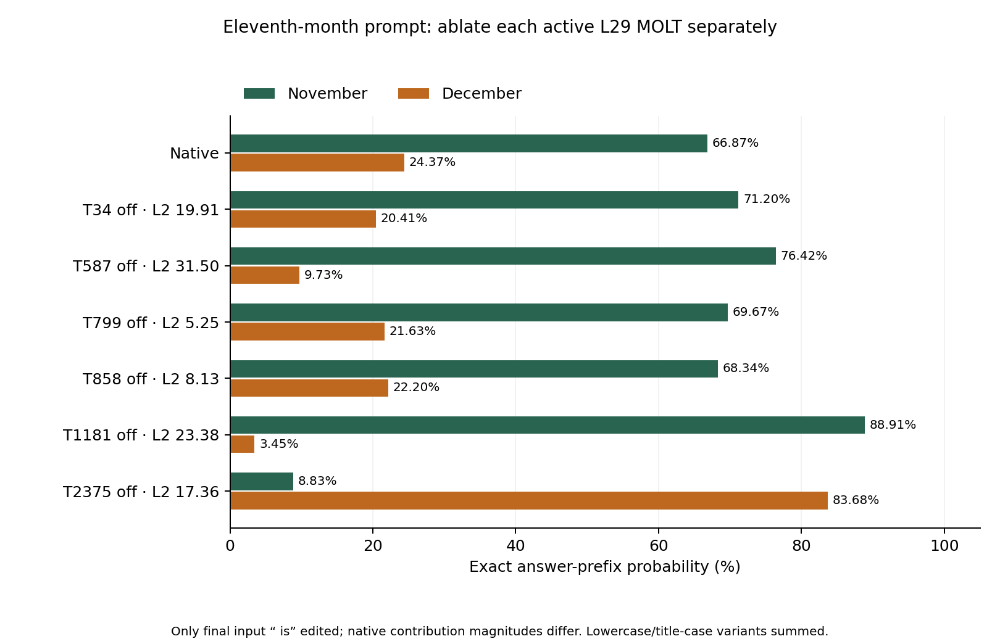

# Active L29 MOLT ablation controls

Prompt: `the eleventh month of the year is`. Only final input position 7 (` is`) is edited. Every active transform is removed separately at its own natural magnitude. No generated-token edits or joint removal.

All 2,480 L29 gates were scanned on the saved native state. Exactly six are active: [34, 587, 799, 858, 1181, 2375]. Selection preceded all ablation outcomes. Runtime reproduces the same active set.

Native initial answer: november. P(November variants) 66.8686%; P(December variants) 24.3655%.

| Transform removed | Natural gate | Contribution L2 | Initial answer | P(November) | P(December) |
|---|---:|---:|---|---:|---:|
| T34 | 1.267216 | 19.9081 | november | 71.1997% | 20.4120% |
| T587 | 1.396032 | 31.4979 | november | 76.4197% | 9.7309% |
| T799 | 0.894027 | 5.2450 | november | 69.6658% | 21.6275% |
| T858 | 0.777515 | 8.1272 | november | 68.3387% | 22.2003% |
| T1181 | 1.516169 | 23.3834 | november | 88.9109% | 3.4474% |
| T2375 | 1.158554 | 17.3579 | december | 8.8313% | 83.6775% |

December-initial removals: [2375]. This is a one-prompt specificity control, not a broad causal-label validation.

Other controls with the entire generated token sequence identical to native: [34, 587, 799, 858, 1181]. The full-vocabulary logits can change while greedy output remains identical.

The natural removed contributions have different norms. These are natural-strength ablations, not equal-norm perturbations. Contribution norm and actual rounded edit norm are retained. Equal or larger unrelated edits that preserve the answer provide a useful comparison; smaller edits do not establish equal-strength specificity.

Probabilities sum exact leading-space lowercase/title-case month-name prefixes, multiplying token probabilities when needed; punctuation/EOS and other renderings excluded. All 12 month-name probabilities are saved.



## Full recorded responses

### Native

```text
 november. the twelfth month is december. the first month is january. the second month is february. the third month is march. the fourth month
```

### T34 off

```text
 november. the twelfth month is december. the first month is january. the second month is february. the third month is march. the fourth month
```

### T587 off

```text
 november. the twelfth month is december. the first month is january. the second month is february. the third month is march. the fourth month
```

### T799 off

```text
 november. the twelfth month is december. the first month is january. the second month is february. the third month is march. the fourth month
```

### T858 off

```text
 november. the twelfth month is december. the first month is january. the second month is february. the third month is march. the fourth month
```

### T1181 off

```text
 november. the twelfth month is december. the first month is january. the second month is february. the third month is march. the fourth month
```

### T2375 off

```text
 december. the twelfth month is january. the tenth month is september. the ninth month is august. the eighth month is july. the seventh month
```

## Method and checks

Same pinned BF16 Qwen3-4B and MOLT checkpoint. Natural contribution = gate * ((z @ V) @ U) * output_std, retaining checkpoint standardizers. Subtract in FP32, then cast selected output once to BF16. Native MLP remainder retained. No extra vector normalization. Eager attention, TF32 off, greedy decoding, 32 generated-token maximum.

Every ablation repeats exactly in token IDs and full-vocabulary logit hashes. Native/observer/zero controls are exact. Native and T2375-off reproduce prior records. The CPU audit reconstructs all gates, operators, probabilities, exact BF16 edits and token masks. All raw files and the archive are hash-verified.

```json
{
  "status": "pass",
  "all_layer_transforms_scanned": 2480,
  "active_at_final_input": 6,
  "other_active_controls": 5,
  "array_files_audited": 15,
  "audited_edit_arrays": 13,
  "probability_max_absolute_error": 6.568987350741295e-07,
  "native_observer_zero_controls_exact": true,
  "native_prior_reference_exact": true,
  "T2375_prior_reference_exact": true,
  "all_six_ablation_repeats_exact": true,
  "all_gate_active_set_reproduced": true,
  "bf16_edits_exact": true,
  "unselected_local_outputs_unchanged": true,
  "no_generated_token_edits": true,
  "full_local_native_MLP_equal_across_edits": true
}
```

Reproduce: `python3 experiments/eleven-active-controls-20261103/analyze.py`. Raw evidence: `comparisons/2026-11-03-eleven-active-controls/`. No publication or GPU cleanup was performed.

## Cached dashboard labels

These descriptions were cached on 21 October, not refreshed live. They describe activation conditions and are not causal explanations of the ablation results.

- T34: Creative Writing Task Requests.
- T587: Temporal and Spatial Context Gate.
- T799: Copula Verb and Predicate Context.
- T858: Temporal Phrases Triggering Seasonal Gate.
- T1181: Christmas Holiday Season Token Activation.
- T2375: High-Activation "Water" Token.

## T1181 follow-up inspection, without new inference

The cached label is “Christmas Holiday Season Token Activation.” In the saved 64-conversation / 54,828-token preview, its five selected windows include Yuletide, peak shopping seasons, birthdays and holidays, a numbered list, and bread-pudding text. This small preview is not the original 10-million-token activation campaign and cannot establish the feature's global dominant behavior.

In preview conversation 39, T2375 fires on newline at position 329 immediately before `11. ArtRebel` (gate 1.96875). T1181 fires on newline at position 336 immediately before `12. AudienceHive` (gate 0.73828125). This is a before-twelve activation example, not a causal test or proof of a general twelve feature.

Applying T1181's gate encoder to saved native final-token states gives approximately 1.516172 for the month prompt, 0.552193 for the alphabet prompt, zero for the Roman prompt, and zero for the element prompt. These are CPU FP32 reductions; their tiny differences from GPU values are numerical. The Roman final-token gate is zero because its raw score 0.390393 is below threshold 0.524234. T1181 therefore is not a shared active final-token component across all three successful domains. This does not exclude a role at other positions or through earlier computation.

A useful proposed follow-up is the four-condition month comparison: native, T2375 off, T1181 off, and both off. Comparing both-off with T2375-only-off tests whether T1181 helps sustain December's advantage after the eleven-related contribution is removed. No joint ablation has been run here. Exact source hashes, token-aligned preview windows, and CPU gate observations are in `T1181-followup-observations.json`.
