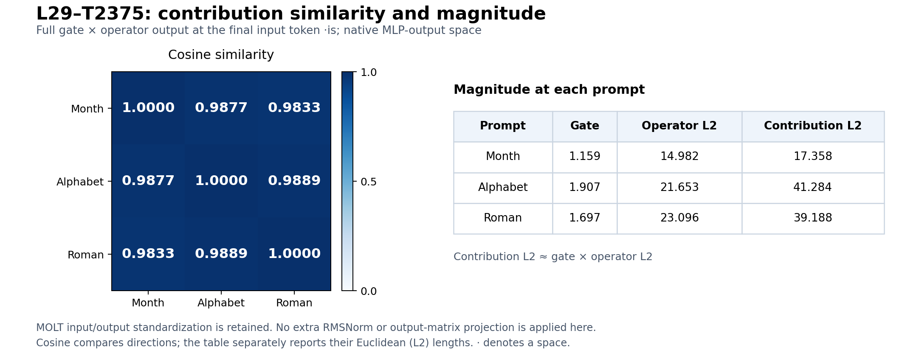

# Original MOLT contribution similarities and magnitudes

The compared vector is the full positive intended contribution c = gate(x) × UV(x), in native L29 MLP-output units, at the final input token ` is`. The three original vectors are compared directly; no fitted shared component is substituted.

No final RMSNorm, learned final RMSNorm gamma, or output-vocabulary matrix is applied for this comparison. Cosine itself divides out each vector’s L2 length.

The MOLT checkpoint’s input and output standardizers remain part of computing c:

```text
z = (residual - input_mean) / input_std
operator = (z @ V @ U) * output_std
c = gate(z) * operator
```

These standardizers are separate from the model’s final RMSNorm. There is no additional RMSNorm applied to the MOLT contribution here. Values use the intended contribution before BF16 subtraction rounding.



| Prompt | Month | Alphabet | Roman |
|---|---:|---:|---:|
| Month | 1.000000 | 0.987673 | 0.983285 |
| Alphabet | 0.987673 | 1.000000 | 0.988861 |
| Roman | 0.983285 | 0.988861 | 1.000000 |

| Prompt | Gate | Operator L2 | Contribution L2 |
|---|---:|---:|---:|---:|
| Month | 1.158554 | 14.982367 | 17.357875 |
| Alphabet | 1.906587 | 21.653243 | 41.283785 |
| Roman | 1.696772 | 23.095515 | 39.187820 |

All three gates are positive scalars. Their scaling changes the contribution magnitudes but mathematically leaves cosine similarities unchanged, so the operator-output directions are aligned as well. The standardizers’ coordinatewise scaling is retained because it defines the actual contribution in native output space.

Exact prompts and positions:

- Month: `the eleventh month of the year is`, position 7.
- Alphabet: `the eleventh letter of the english alphabet is`, position 8.
- Roman: `the eleventh positive integer in roman numerals is`, position 9.

This is a descriptive comparison of three selected prompts with shared ordinal wording. Geometric alignment is not a measure of causal importance or proof of a general ordinal mechanism. No GPU inference was needed.

[Cosine CSV](cosine-similarity.csv) · [Magnitude CSV](magnitudes.csv) · [Values and source hashes](summary.json)
