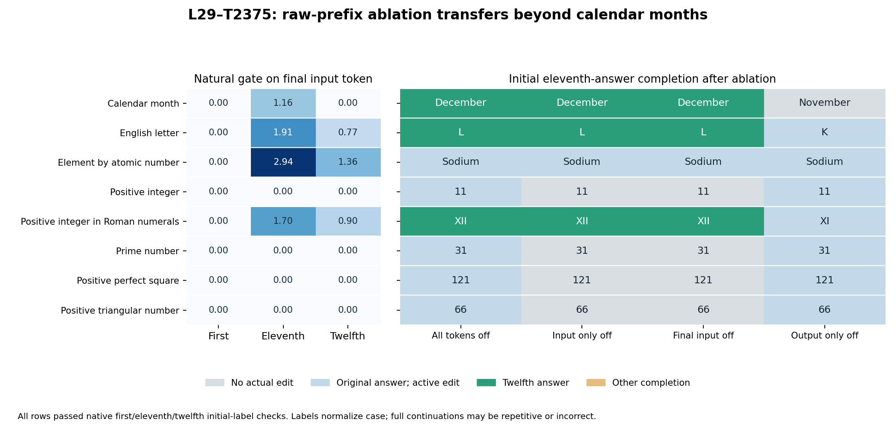

# Raw-prefix ordinal ablations — 28 October 2026

**The month finding generalizes to alphabet letters and Roman numerals in these raw completion prefixes.** Turning off L29–T2375 only at the final input token changes November → December, K → L, and XI → XII. These are initial-completion effects; long raw continuations are not generally coherent or factually reliable.



## Capability controls before interventions

Ten primary domains were screened with native first, eleventh and twelfth prefixes, each plus an exact zero-strength observer. All three initial labels had to pass manual review before any ablation. Eight passed. The lowercase president and ordered-list prefixes failed. Two adaptive president rephrasings were then tested; neither correctly completed the eleventh-president name, so neither was ablated.

| Family | Native first / eleventh / twelfth expected labels | Eligible? | Reason |
|---|---|---|---|
| month | January / November / December | yes | All three initial answer labels/numbers correct on manual review. |
| president | Washington / Polk / Taylor | no | Prefixes continue into false descriptive clauses rather than correct direct president-name completions. A later Taylor mention does not repair the incorrect initial description; no ablation. |
| alphabet | A / K / L | yes | All three initial answer labels/numbers correct on manual review. |
| element | Hydrogen / Sodium / Magnesium | yes | All three initial answer labels/numbers correct on manual review. |
| integer | 1 / 11 / 12 | yes | All three initial answer labels/numbers correct on manual review. |
| roman | I / XI / XII | yes | Initial I, XI and XII numerals are correct. Later XI continuation confuses this with letter K. Eligibility is restricted to the initial completion, not whole-response coherence. |
| prime | 2 / 31 / 37 | yes | All three initial answer labels/numbers correct on manual review. |
| square | 1 / 121 / 144 | yes | All three initial answer labels/numbers correct on manual review. |
| triangular | 1 / 66 / 78 | yes | All three initial answer labels/numbers correct on manual review. |
| list | apple / violin / window | no | Eleventh prefix initially answers jungle (tenth item); twelfth starts a derivation/enumeration rather than the required window. No verified direct 11th/12th completion; no ablation. |
| president_standard_case | Washington / Polk / Taylor | no | First prefix leads into a quiz rather than a direct name; eleventh and twelfth both incorrectly answer John Quincy Adams. |
| president_name_field | Washington / Polk / Taylor | no | First Washington and twelfth Taylor identifiable, but eleventh incorrectly answers Martin Van Buren. No ablation. |

Initial-label correctness is separate from whole-continuation coherence. For example, the native Roman completion begins XI and later confuses the task with the English letter K. All raw continuations and exclusions are retained.

The prime, square and triangular controls now produce the correct initial eleventh/twelfth values. Their earlier chat-question exclusions do not apply automatically to these new raw-prefix prompts.

## Ablation outcomes

| Domain | Native eleventh | Expected twelfth | Gate at last input | All tokens off | Input only off | Last input only off | Output only off |
|---|---|---|---:|---|---|---|---|
| Calendar month | November | December | 1.158554 | December | December | December | November |
| English letter | K | L | 1.906587 | L | L | L | K |
| Element by atomic number | Sodium | Magnesium | 2.939096 | Sodium | Sodium | Sodium | Sodium |
| Positive integer | 11 | 12 | 0.000000 | 11 | 11 | 11 | 11 |
| Positive integer in Roman numerals | XI | XII | 1.696772 | XII | XII | XII | XI |
| Prime number | 31 | 37 | 0.000000 | 31 | 31 | 31 | 31 |
| Positive perfect square | 121 | 144 | 0.000000 | 121 | 121 | 121 | 121 |
| Positive triangular number | 66 | 78 | 0.000000 | 66 | 66 | 66 | 66 |

A gray plot cell means the selected intervention made no actual local MLP edit; this is distinct from removing an active contribution without changing the first label. Integers, primes, squares and triangular numbers have zero natural gate on the final input token in their eleventh prefixes. Their final-token ablation exactly reproduces the native generation. Sodium is an active-gate case that retains its original first label after removal.

All first- and twelfth-prefix specificity controls retain their original initial labels after final-input ablation. Several twelfth-prefix gates are active; unchanged greedy output does not establish zero confidence effect.

## Successful single-position conditions

### Calendar month

Prompt: `the eleventh month of the year is`

Native initial label: **November**. Gate off initial label: **December**. Natural final-token gate: 1.158553600. Only one input position is edited; generated positions receive no edit.

**Native continuation**

```text
 november. the twelfth month is december. the first month is january. the second month is february. the third month is march. the fourth month is april. the fifth month is may. the sixth month is june. the seventh month is july. the eighth month is august. the ninth month
```

**Final-input ablation continuation**

```text
 december. the twelfth month is january. the tenth month is september. the ninth month is august. the eighth month is july. the seventh month is june. the sixth month is may. the fifth month is april. the fourth month is march. the third month is february. the second month
```

### English letter

Prompt: `the eleventh letter of the english alphabet is`

Native initial label: **K**. Gate off initial label: **L**. Natural final-token gate: 1.906586647. Only one input position is edited; generated positions receive no edit.

**Native continuation**

```text
 k. the eleventh letter of the greek alphabet is kappa. the eleventh letter of the russian alphabet is ё. the eleventh letter of the chinese alphabet is 什么？ The eleventh letter of the Chinese alphabet is not applicable, as the Chinese alphabet does not have letters in the same way as the
```

**Final-input ablation continuation**

```text
 l. the eleventh letter of the english alphabet is l. the eleventh letter of the english alphabet is l. the eleventh letter of the english alphabet is l. the eleventh letter of the english alphabet is l. the eleventh letter of the english alphabet is l. the eleventh letter of the english
```

### Positive integer in Roman numerals

Prompt: `the eleventh positive integer in roman numerals is`

Native initial label: **XI**. Gate off initial label: **XII**. Natural final-token gate: 1.696771860. Only one input position is edited; generated positions receive no edit.

**Native continuation**

```text
 xi, but the eleventh letter of the alphabet is k. So, the answer is k. But wait, the question is about the eleventh positive integer, not the eleventh letter. So, the eleventh positive integer is 11, which is xi in Roman numerals. But the question is asking
```

**Final-input ablation continuation**

```text
 xii, but the eleventh letter of the alphabet is k. So, the eleventh positive integer is xii, but the eleventh letter is k. So, the eleventh positive integer is xii, but the eleventh letter is k. So, the eleventh positive integer is xii, but
```

## Conditional probability diagnostics

For each eligible domain, compare the first differing token in the actual native eleventh and twelfth initial completions. Probabilities are compared only if the ablated generation shares the preceding native output prefix. This is a conditional branch-token diagnostic, not a full-answer probability or a sum across answer spellings. Exact token strings, positions and values are in branch-probabilities.json.

| Case | Native eleventh branch token | Native twelfth branch token | Native P(twelfth branch) | Ablated P(twelfth branch) |
|---|---|---|---:|---:|
| month | ' november' | ' december' | 15.870599% | 52.085859% |
| alphabet | ' k' | ' l' | 0.514288% | 19.408286% |
| element | ' sodium' | ' magnesium' | 0.000067% | 0.000676% |
| integer | '1' | '2' | 0.458701% | 0.458701% |
| roman | ' xi' | ' x' | 13.834167% | 44.199491% |
| prime | '1' | '7' | 0.001893% | 0.001893% |
| square | '2' | '4' | 0.006546% | 0.006546% |
| triangular | '6' | '7' | 0.020280% | 0.020280% |

## Method, checks and limits

Same pinned native BF16 Qwen3-4B and FP32 MOLT layer-29 slice as the previous replication. Raw text only, no chat/BOS tokens, greedy decoding, 64 generated tokens, eager attention, TF32 off, fresh cache per run. Each selected native MLP output receives `-natural_gate * ((z @ V) @ U) * output_std`, FP32 then one BF16 cast. Native MLP remainder retained; all other features remain native. No high fixed gates or trained weights.

Independent CPU audit passed: 136 runs, 460 saved vector files / 672 sampled positions, 6585 processed-position checks. Encoder, gate, operator and exact BF16 edits reconstructed. Native/zero-strength controls and repeated native/all-off runs match exactly. Hooks removed. Native and one-position-ablated month completions exactly reproduce the previous experiment over the shared generated prefix.

These selected raw-prefix results establish effects beyond month names; they do not establish a universal ordinal operation or an exclusive interpretation of the gate. The input-dependent operator and native answer margins differ across domains. No active norm-matched other-transform controls or broad paraphrase study was performed. Inactive-gate cases are no-ops, not evidence that removing an active feature failed.

Ground truth for mathematical sequences, alphabet indices and the explicit list was checked independently in ground-truth.json. Expected presidential and element names were checked against primary sources: [US Senate, Taylor as 12th president](https://www.inaugural.senate.gov/16th-inaugural-ceremonies/) and [Royal Society of Chemistry, magnesium atomic number 12](https://periodic-table.rsc.org/element/12/magnesium).

[All ablated continuations](responses.csv) · [Capability controls](controls.json) · [Conditional branch probabilities](branch-probabilities.json) · [Validation](validation.json)
