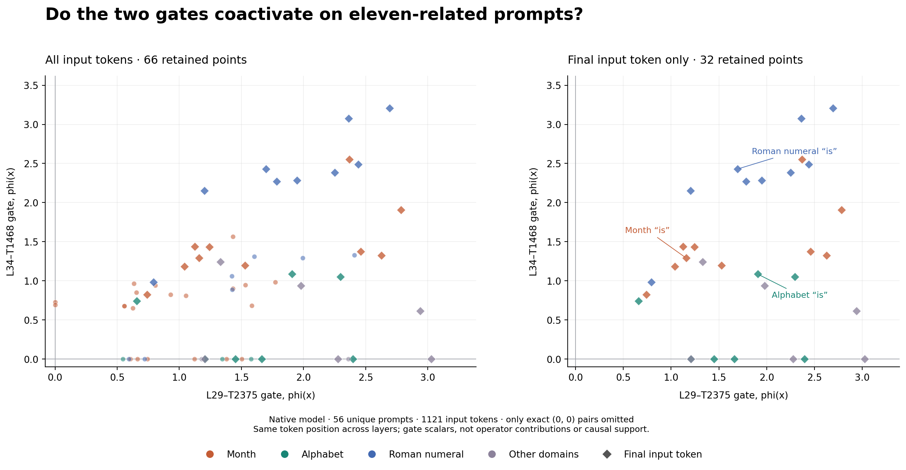

# Natural coactivation of L29-T2375 and L34-T1468

Measured all input tokens in **56 distinct historical eleven-related inputs**, spanning five languages, ten domains and raw/chat formats. Both gates are scored on the unmodified native model. No ablation or new generation was performed.

[Interactive scatter](index.html) · [All token pairs, including zeros](all-token-pairs.csv) · [Plotted points](plotted-token-pairs.csv) · [Prompt summary](prompt-summary.csv)

**One point = the same prompt and token position in L29 and L34.** x is L29-T2375 and y is L34-T1468. Values use each checkpoint encoder, learned threshold and input standardizers. No UVx, contribution normalization or final RMSNorm is applied.

Of 1121 input-token pairs, 43 have both gates active, 21 have only T2375 active, 2 have only T1468 active and 1055 have both zero. Only the last group is omitted from the scatter. It remains in the downloadable data.

T2375 activates somewhere in 37/56 prompts; T1468 in 30/56; both activate at the same token in 30/56 prompts.

Pearson r is 0.389 among the retained points and 0.769 when all double-zero points are included. The higher zero-inclusive value partly reflects shared silence; these dependent token observations do not support a significance claim.

## Interpretation limits

- Gate scalars only: no UVx, full MOLT contribution, contribution norm or causal support is measured.
- Native later MLPs remain unchanged; MOLT encoders are diagnostics on the native hidden states.
- These are selected historical eleven-related inputs, not a held-out sample or eleven-vs-other-ordinal specificity control.
- Token points within/across related prompts are dependent; Pearson values are descriptive, with no significance claim.
- Dropping (0,0) conditions the plotted sample and can change its apparent correlation. All points are retained in the CSV.
- Every point pairs the same token coordinate across layers. Separate per-prompt maxima are never paired.
- Input tokens only, including recorded chat wrappers; generated continuations are excluded.

The scatter checks coactivation. Positive coactivation does not by itself show that either transform supports the eleven answer, and this eleven-only set does not establish ordinal specificity.

## Verification

All 56 captures have SHA-256-verified files and exact unhooked/observed full-vocabulary logits at the final input position. The three original month/alphabet/Roman inputs also reproduce their prior native input states and logits exactly and repeat exactly. FP32/FP64 evaluation agrees on every one of 2242 gate membership decisions.

## Original reference prompts

| Prompt | L29-T2375 at final is | L34-T1468 at final is |
|---|---:|---:|
| `the eleventh month of the year is` | 1.158554 | 1.289993 |
| `the eleventh letter of the english alphabet is` | 1.906587 | 1.084717 |
| `the eleventh positive integer in roman numerals is` | 1.696772 | 2.429366 |

## Reproduce

Source: experiments/eleven-gate-coactivation-20261103/. Build the catalog, capture native layer-specific inputs on the pinned model, then run analyze.py and render.py. catalog.json enumerates every included prompt and its historical source; summary.json retains source hashes, raw encoder scores and all zero pairs.
