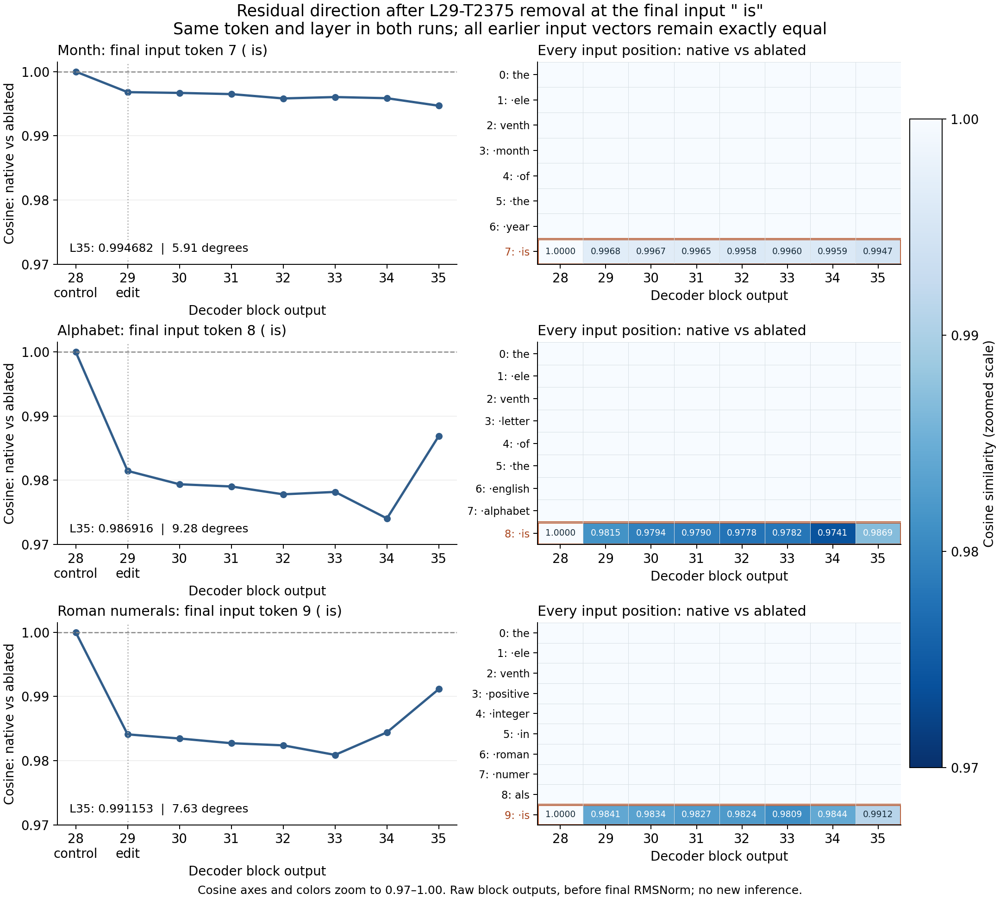

# Native versus ablated residual cosine at each input token

Native versus T2375-off full residual vectors at the same input position after the same decoder block. All later layers compute normally.

Only L29-T2375 at the final input is. L28 is a pre-edit control. L35 is before final RMSNorm and unembedding.

The left panels show the edited final input ` is`. The right panels compare every input token at every saved layer, with the edited row outlined in orange. All earlier positions are exactly unchanged: cosine 1, angle 0 degrees. Both axes and colors are zoomed to 0.97–1.00.

| Block | Month | Alphabet | Roman numerals |
|---|---:|---:|---:|
| 28 (control) | 1.000000 | 1.000000 | 1.000000 |
| 29 | 0.996800 | 0.981467 | 0.984094 |
| 30 | 0.996683 | 0.979384 | 0.983449 |
| 31 | 0.996496 | 0.979036 | 0.982716 |
| 32 | 0.995821 | 0.977816 | 0.982383 |
| 33 | 0.996037 | 0.978189 | 0.980893 |
| 34 | 0.995857 | 0.974058 | 0.984412 |
| 35 | 0.994682 | 0.986916 | 0.991153 |

| Prompt | L29 angle | L35 angle | Largest angle after edit |
|---|---:|---:|---:|
| Month | 4.585 degrees | 5.912 degrees | 5.912 degrees at L35 |
| Alphabet | 11.048 degrees | 9.279 degrees | 13.079 degrees at L34 |
| Roman numerals | 10.233 degrees | 7.627 degrees | 11.218 degrees at L33 |

## Exact prompts

- Month: `the eleventh month of the year is`. Edited position 7.
- Alphabet: `the eleventh letter of the english alphabet is`. Edited position 8.
- Roman numerals: `the eleventh positive integer in roman numerals is`. Edited position 9.

Cosine does not decrease monotonically. Alphabet and Roman cases become more aligned again at L35. The comparison concerns whole residual vectors, not isolated MOLT contributions and not vectors from different prompts.

FP64 cosine and arccos in degrees on saved FP32 copies of BF16 residuals. No extra RMSNorm. Exact equality is recorded as cosine 1 and angle 0.

Only input positions were saved; no generated-token residuals are inferred. High whole-residual cosine can coexist with an answer change.

Raw file hashes and all per-token cosine/angle values are in `residual-cosines.json` and `residual-cosines-all-input-tokens.csv`.

Reproduce: `python3 experiments/eleven-residual-trace-20261103/plot_cosines.py`.
