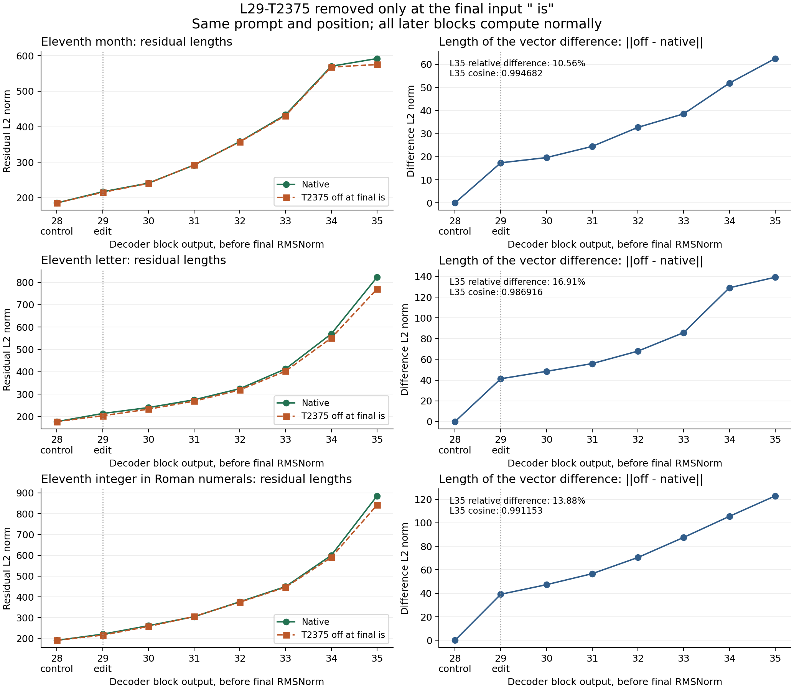

# Residual propagation after final-input L29-T2375 removal

Three exact raw completion prefixes, without a chat wrapper. Only the selected natural contribution at the last input ` is` is removed. Later layers compute normally. No generated tokens are processed in this comparison.

Each residual is captured after a complete decoder block. L28 is a pre-edit control. L35 is the final block output, before final RMSNorm and unembedding. These vectors receive no extra normalization.

## Eleventh month

Prompt: `the eleventh month of the year is`. Edited input position: 7. Natural gate: 1.158554.

First token: ` november` -> ` december`. The Roman ` x` token is only a prefix; this experiment does not generate or score the complete XII answer.

| Block | Native norm | Gate-off norm | Difference norm | Relative difference | Cosine |
|---|---:|---:|---:|---:|---:|
| 28 (control) | 185.5018 | 185.5018 | 0.0000 | 0.000% | 1.000000 |
| 29 | 216.8466 | 215.1573 | 17.3622 | 8.007% | 0.996800 |
| 30 | 241.1033 | 240.4953 | 19.6233 | 8.139% | 0.996683 |
| 31 | 292.0230 | 292.5258 | 24.4724 | 8.380% | 0.996496 |
| 32 | 358.1054 | 357.3153 | 32.7104 | 9.134% | 0.995821 |
| 33 | 433.5929 | 431.3074 | 38.5666 | 8.895% | 0.996037 |
| 34 | 570.3184 | 568.1029 | 51.8596 | 9.093% | 0.995857 |
| 35 | 591.9406 | 574.9884 | 62.5088 | 10.560% | 0.994682 |

Difference norm at L35 / difference norm at L29: 3.6003.

## Eleventh letter

Prompt: `the eleventh letter of the english alphabet is`. Edited input position: 8. Natural gate: 1.906587.

First token: ` k` -> ` l`. The Roman ` x` token is only a prefix; this experiment does not generate or score the complete XII answer.

| Block | Native norm | Gate-off norm | Difference norm | Relative difference | Cosine |
|---|---:|---:|---:|---:|---:|
| 28 (control) | 176.8556 | 176.8556 | 0.0000 | 0.000% | 1.000000 |
| 29 | 213.1315 | 203.1463 | 41.2860 | 19.371% | 0.981467 |
| 30 | 239.6422 | 232.5396 | 48.4580 | 20.221% | 0.979384 |
| 31 | 274.4492 | 268.4552 | 55.9021 | 20.369% | 0.979036 |
| 32 | 324.2851 | 318.5623 | 67.9429 | 20.952% | 0.977816 |
| 33 | 412.7928 | 402.7300 | 85.7498 | 20.773% | 0.978189 |
| 34 | 569.7088 | 550.9164 | 128.9872 | 22.641% | 0.974058 |
| 35 | 822.9808 | 770.4054 | 139.1252 | 16.905% | 0.986916 |

Difference norm at L35 / difference norm at L29: 3.3698.

## Eleventh integer in Roman numerals

Prompt: `the eleventh positive integer in roman numerals is`. Edited input position: 9. Natural gate: 1.696772.

First token: ` xi` -> ` x`. The Roman ` x` token is only a prefix; this experiment does not generate or score the complete XII answer.

| Block | Native norm | Gate-off norm | Difference norm | Relative difference | Cosine |
|---|---:|---:|---:|---:|---:|
| 28 (control) | 190.9906 | 190.9906 | 0.0000 | 0.000% | 1.000000 |
| 29 | 220.4835 | 216.0404 | 39.1798 | 17.770% | 0.984094 |
| 30 | 261.2750 | 257.7248 | 47.3450 | 18.121% | 0.983449 |
| 31 | 304.5653 | 305.4936 | 56.7199 | 18.623% | 0.982716 |
| 32 | 376.4853 | 374.4948 | 70.5102 | 18.729% | 0.982383 |
| 33 | 449.3422 | 446.4595 | 87.6036 | 19.496% | 0.980893 |
| 34 | 599.9720 | 590.1056 | 105.5239 | 17.588% | 0.984412 |
| 35 | 885.6056 | 841.9465 | 122.8813 | 13.875% | 0.991153 |

Difference norm at L35 / difference norm at L29: 3.1363.

## Interpretation and verification

Vector-change magnitude localizes amplification or contraction. It does not identify which attention/MLP computation causes the answer change or establish a general ordinal increment.

Earlier prompt positions stay exactly unchanged across all observed layers. L28 is unchanged. Unhooked/observed/zero-strength native logits agree exactly, ablation repeats agree on every saved array, and the prior native full logits and pre-final-norm residual reproduce exactly. The natural MOLT contribution, BF16 MLP edit, and subsequent L29 residual addition were independently reconstructed locally.

The full native/ablated vectors for every input position are in the hash-verified remote export; the CSV includes L28 and all requested L29-L35 measurements. Metrics are recomputed in FP64 from the saved FP32 copies of BF16 vectors.

Reproduce: `python3 experiments/eleven-residual-trace-20261103/analyze.py`.

Sources: `comparisons/2026-11-03-eleven-residual-trace/remote-export/eleven-residual-20261103/`. Pinned model/runtime versions, source hashes, exact prompts and numerical audit errors are in `summary.json`.
