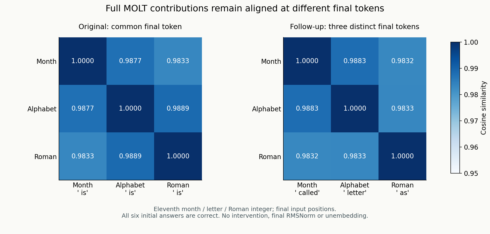
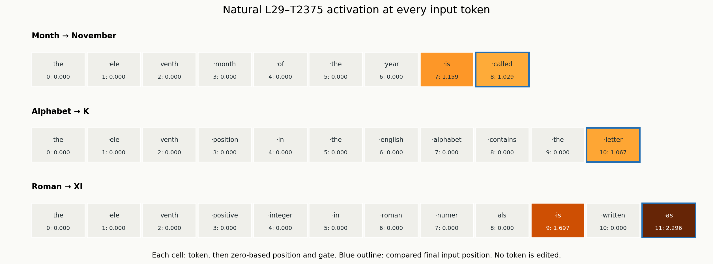
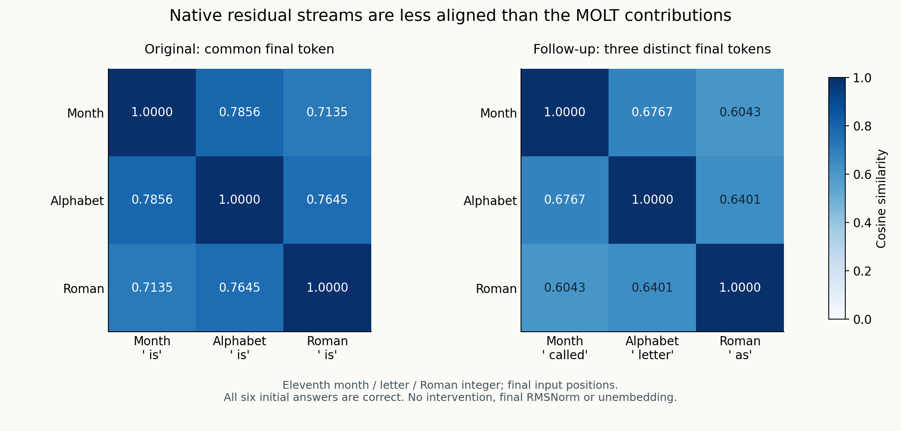

# T2375 contribution alignment with different final input tokens

8 November 2026 · Qwen3-4B · natural activations only

The shared final ` is` token is not sufficient to explain the original high
cross-domain contribution cosine. In the clearer follow-up, the final tokens are
` called`, ` letter` and ` as`, all with different IDs. All three initial answers
are correct, and the pairwise full-contribution cosines remain 0.983179–0.988280.
This is observational geometry, not a new ablation or proof of an eleven-only feature.



## Exact rewritten eleventh prompts

| Domain | Raw prompt | Final token / ID | Position | Gate | Contribution L2 | Initial answer |
|---|---|---|---|---|---|---|
| month | `the eleventh month of the year is called` | ' called' / 2598 | 8 | 1.029329 | 14.448688 | November |
| alphabet | `the eleventh position in the english alphabet contains the letter` | ' letter' / 6524 | 10 | 1.067014 | 18.758959 | K |
| roman | `the eleventh positive integer in roman numerals is written as` | ' as' / 438 | 11 | 2.296153 | 66.335327 | XI |

## Where the gate activates



The month gate is active at ` is` and ` called`; alphabet at ` letter`; Roman at ` is` and ` as`. The fixed final positions, rather than peak-cosine tokens, supply the main matrix. No generated-token activation is used.

|  | Month: called | Alphabet: letter | Roman: as |
|---|---|---|---|
| Month | 1.000000 | 0.988280 | 0.983179 |
| Alphabet | 0.988280 | 1.000000 | 0.983316 |
| Roman | 0.983179 | 0.983316 | 1.000000 |

The corresponding residual-stream cosines are 0.604279–0.676747. Operator and contribution cosine are equal for positive scalar gates; their magnitudes differ.



## Scope and adaptive follow-up

The initial frozen pilot used 27 prompts: three domains × three phrasings ×
three ordinals (10, 11, 12). Some rewrites were ambiguous: month `named` prompted
etymology, alphabet `symbol` prompted chemical-element continuations, and Roman
`representation` often prompted clarification. These failures are retained.

After inspecting responses and gate traces, before calculating follow-up cosines,
we added a clearly labelled nine-run follow-up with endings called/letter/as.
Six prompts were new; three alphabet prompts were exact repeats. Across both
phases there are 36 runs covering 33 distinct prompts, with 369 captured input
positions. The clearer triplet was chosen for answer-slot clarity, not by cosine.

## Matched ordinal controls

Gate activity and direction are not exclusive to eleven. Correctly answered
Roman tenth/twelfth controls also activate at ` as`; original alphabet J/L and
Roman X/XII controls also activate at ` is`. The original tenth-month prompt
incorrectly answers November; the rewritten tenth-month prompt begins with a
clarification and later gives October with a contradictory explanation. Both are
flagged as failed/ambiguous capability controls rather than clean successes.

| Domain | Ordinal | Final token | Gate | Native capability | Native response excerpt |
|---|---|---|---|---|---|
| month | 10 | ' called' | 0.669505 | None |  what? The tenth month of the year is called October. It's the third month of the year in the Gregor… |
| month | 11 | ' called' | 1.029329 | True |  November. The eleventh month of the year is called November. The eleventh month of the year is call… |
| month | 12 | ' called' | 0.000000 | True |  December. The twelfth month of the year is called December. The twelfth month of the year is called… |
| alphabet | 10 | ' letter' | 0.000000 | True |  'j', right? Let me check. The alphabet is a, b, c, d, e, f, g, h, i, j...… |
| alphabet | 11 | ' letter' | 1.067014 | True |  'k', and the 12th position contains the letter 'l'. What is the 13th position?  Let me think. So,… |
| alphabet | 12 | ' letter' | 0.000000 | True |  'l', and the twelfth letter from the end is 'l' as well. is this possible? explain. Okay, let's see… |
| roman | 10 | ' as' | 0.879720 | True |  x. what is the 10th positive integer in the sequence 1, 2, 3, 4, 5, 6,… |
| roman | 11 | ' as' | 2.296153 | True |  xi. the eleventh positive integer in the sequence of numbers that are not multiples of 5 is 12. the… |
| roman | 12 | ' as' | 0.995811 | True |  xii. the twelfth positive integer in base 10 is 12. the twelfth positive integer in base 10 is 12… |

## Verification and measurements

- Native model and observer runs have identical generated IDs and every measured next-token logit hash, for all 36 runs.
- The three original eleventh anchors reproduce the saved native residual arrays and full first-token logits exactly.
- Independent CPU checks reproduce normalization, gate membership, raw scores, operators and contributions in both phases.
- Both remote archives were downloaded and every manifest-listed file was SHA-256 verified locally.
- No gate or MLP contribution was changed. There is no final RMSNorm or unembedding in the cosine calculation.
- All active cross-domain input-token pairs are retained, separated by equal/different token IDs. A zero contribution has undefined cosine.

## All native responses

Correctness refers to the initial target answer; it does not certify a coherent
32-token continuation. `null` means ambiguous initial-answer capability.


### Initial frozen pilot


#### original-month-10

Prompt: `the tenth month of the year is`

Expected: October. Native initial-answer review: False. Initial November is incorrect for the tenth month.

```text
 november. is that correct? Yes, that's correct. The tenth month of the year is November. In the Gregorian calendar, which is the calendar system
```

Active input positions: 6 ' is': 0.799371.

#### original-month-11

Prompt: `the eleventh month of the year is`

Expected: November. Native initial-answer review: True. Expected target is the initial answer, allowing introductory as/of and quotation marks; no claim about the whole continuation.

```text
 november. the twelfth month is december. the first month is january. the second month is february. the third month is march. the fourth month
```

Active input positions: 7 ' is': 1.158554.

#### original-month-12

Prompt: `the twelfth month of the year is`

Expected: December. Native initial-answer review: True. Expected target is the initial answer, allowing introductory as/of and quotation marks; no claim about the whole continuation.

```text
 december. the twelfth month of the year is december. the twelfth month of the year is december. the twelfth month of the year is december.
```

Active input positions: .

#### original-alphabet-10

Prompt: `the tenth letter of the english alphabet is`

Expected: J. Native initial-answer review: True. Expected target is the initial answer, allowing introductory as/of and quotation marks; no claim about the whole continuation.

```text
 j. is this statement true or false? The tenth letter of the English alphabet is J. Let's think about this. The English alphabet has 26
```

Active input positions: 7 ' is': 0.754783.

#### original-alphabet-11

Prompt: `the eleventh letter of the english alphabet is`

Expected: K. Native initial-answer review: True. Expected target is the initial answer, allowing introductory as/of and quotation marks; no claim about the whole continuation.

```text
 k. the eleventh letter of the greek alphabet is kappa. the eleventh letter of the russian alphabet is ё. the eleventh letter of the
```

Active input positions: 8 ' is': 1.906587.

#### original-alphabet-12

Prompt: `the twelfth letter of the english alphabet is`

Expected: L. Native initial-answer review: True. Expected target is the initial answer, allowing introductory as/of and quotation marks; no claim about the whole continuation.

```text
 l. the twelfth letter of the greek alphabet is mu. the twelfth letter of the russian alphabet is ё. the twelfth letter of the
```

Active input positions: 8 ' is': 0.772023.

#### original-roman-10

Prompt: `the tenth positive integer in roman numerals is`

Expected: X. Native initial-answer review: True. Expected target is the initial answer, allowing introductory as/of and quotation marks; no claim about the whole continuation.

```text
 x. what is the tenth positive integer in base 10? To solve this problem, we need to understand the question carefully. The problem states:

>
```

Active input positions: 8 ' is': 0.923497.

#### original-roman-11

Prompt: `the eleventh positive integer in roman numerals is`

Expected: XI. Native initial-answer review: True. Expected target is the initial answer, allowing introductory as/of and quotation marks; no claim about the whole continuation.

```text
 xi, but the eleventh letter of the alphabet is k. So, the answer is k. But wait, the question is about the eleventh positive integer
```

Active input positions: 9 ' is': 1.696772.

#### original-roman-12

Prompt: `the twelfth positive integer in roman numerals is`

Expected: XII. Native initial-answer review: True. Expected target is the initial answer, allowing introductory as/of and quotation marks; no claim about the whole continuation.

```text
 xii, and the twelfth positive integer in the sequence of numbers that are not multiples of 3 is 14. what is the twelfth positive
```

Active input positions: 9 ' is': 0.903831.

#### word_rewrite-month-10

Prompt: `the tenth month of the year is named`

Expected: October. Native initial-answer review: False. Continues with an etymology rather than providing the requested month name.

```text
 after the Roman god of the sea, Neptune.  Neptune is also the god of the sea.  So, the tenth month is named after Neptune, the
```

Active input positions: 6 ' is': 0.799371, 7 ' named': 0.680681.

#### word_rewrite-month-11

Prompt: `the eleventh month of the year is named`

Expected: November. Native initial-answer review: False. Continues with an etymology rather than providing the requested month name.

```text
 after the Roman god of the moon, which is also the name of a famous Roman general. What is the name of the month?

The eleventh month of
```

Active input positions: 7 ' is': 1.158554, 8 ' named': 1.092533.

#### word_rewrite-month-12

Prompt: `the twelfth month of the year is named`

Expected: December. Native initial-answer review: False. Continues with an etymology rather than providing the requested month name.

```text
 after the Roman god of the sea, which is also the name of a famous American author. What is the name of the month and the author? The tw
```

Active input positions: .

#### word_rewrite-alphabet-10

Prompt: `the tenth position in the english alphabet contains the letter`

Expected: J. Native initial-answer review: True. Expected target is the initial answer, allowing introductory as/of and quotation marks; no claim about the whole continuation.

```text
 'j', right? Let me check. The alphabet is a, b, c, d, e, f, g, h, i, j...
```

Active input positions: .

#### word_rewrite-alphabet-11

Prompt: `the eleventh position in the english alphabet contains the letter`

Expected: K. Native initial-answer review: True. Expected target is the initial answer, allowing introductory as/of and quotation marks; no claim about the whole continuation.

```text
 'k', and the 12th position contains the letter 'l'. What is the 13th position?  Let me think. So,
```

Active input positions: 10 ' letter': 1.067014.

#### word_rewrite-alphabet-12

Prompt: `the twelfth position in the english alphabet contains the letter`

Expected: L. Native initial-answer review: True. Expected target is the initial answer, allowing introductory as/of and quotation marks; no claim about the whole continuation.

```text
 'l', and the twelfth letter from the end is 'l' as well. is this possible? explain.
Okay, let's see. The question
```

Active input positions: .

#### word_rewrite-roman-10

Prompt: `the tenth positive integer in roman numerals is written`

Expected: X. Native initial-answer review: True. Expected target is the initial answer, allowing introductory as/of and quotation marks; no claim about the whole continuation.

```text
 as x. what is the 10th positive integer in the sequence 1, 2, 3, 4, 5, 6
```

Active input positions: 8 ' is': 0.923497.

#### word_rewrite-roman-11

Prompt: `the eleventh positive integer in roman numerals is written`

Expected: XI. Native initial-answer review: True. Expected target is the initial answer, allowing introductory as/of and quotation marks; no claim about the whole continuation.

```text
 as xi. the eleventh positive integer in the sequence of numbers that are not multiples of 5 is 12. the eleventh positive integer in the
```

Active input positions: 9 ' is': 1.696772.

#### word_rewrite-roman-12

Prompt: `the twelfth positive integer in roman numerals is written`

Expected: XII. Native initial-answer review: True. Expected target is the initial answer, allowing introductory as/of and quotation marks; no claim about the whole continuation.

```text
 as xii. the twelfth positive integer in base 10 is 12. the twelfth positive integer in base 10 is 1
```

Active input positions: 9 ' is': 0.903831.

#### digit_rewrite-month-10

Prompt: `month number 10 in the calendar has the name`

Expected: October. Native initial-answer review: False. Continues into a palindrome question; no correct month answer in the excerpt.

```text
 of the month in the form of a word that is a palindrome. What is the name of the month?

To solve this, we need to find the
```

Active input positions: 10 ' name': 1.234421.

#### digit_rewrite-month-11

Prompt: `month number 11 in the calendar has the name`

Expected: November. Native initial-answer review: True. Expected target is the initial answer, allowing introductory as/of and quotation marks; no claim about the whole continuation.

```text
 of November. The month number 12 is December. So, the month number 1 is January, 2 is February, and so on. So
```

Active input positions: 10 ' name': 2.180418.

#### digit_rewrite-month-12

Prompt: `month number 12 in the calendar has the name`

Expected: December. Native initial-answer review: True. Expected target is the initial answer, allowing introductory as/of and quotation marks; no claim about the whole continuation.

```text
 of December.  The month number 12 is December.  The month number 12 is December.  The month number 12 is December
```

Active input positions: .

#### digit_rewrite-alphabet-10

Prompt: `for position 10 in the english alphabet, give the symbol`

Expected: J. Native initial-answer review: False. Switches to chemical-element symbols instead of answering the alphabet question.

```text
 for the element with that position in the periodic table.  Also, give the symbol for the element with position 10 in the periodic table.  Also
```

Active input positions: .

#### digit_rewrite-alphabet-11

Prompt: `for position 11 in the english alphabet, give the symbol`

Expected: K. Native initial-answer review: False. Switches to chemical-element symbols instead of answering the alphabet question.

```text
 for the element with that position in the periodic table.  Also, give the symbol for the element with position 11 in the periodic table.  Also
```

Active input positions: .

#### digit_rewrite-alphabet-12

Prompt: `for position 12 in the english alphabet, give the symbol`

Expected: L. Native initial-answer review: False. Switches to chemical-element symbols instead of answering the alphabet question.

```text
 for the element in the periodic table with the same number. Also, give the name of the element and the number of protons in the nucleus of that element
```

Active input positions: .

#### digit_rewrite-roman-10

Prompt: `integer 10 expressed using roman numerals has the representation`

Expected: X. Native initial-answer review: None. Starts with a clarification question before later giving the expected numeral; ambiguous initial-answer capability.

```text
 of what? The answer is X. But how to explain this? Let me think. Roman numerals use letters to represent numbers. The basic symbols are I
```

Active input positions: .

#### digit_rewrite-roman-11

Prompt: `integer 11 expressed using roman numerals has the representation`

Expected: XI. Native initial-answer review: False. Starts with clarification and switches to unrelated Roman numerals; no XI answer in the excerpt.

```text
 of what? Also, what is the value of the Roman numeral MCMXCIV? Additionally, what is the value of the Roman numeral CDXLII?
```

Active input positions: .

#### digit_rewrite-roman-12

Prompt: `integer 12 expressed using roman numerals has the representation`

Expected: XII. Native initial-answer review: None. Starts with a clarification question before later giving the expected numeral; ambiguous initial-answer capability.

```text
 of what? The answer is XII. But how do I get there? Let me think. So, the Roman numerals are based on certain symbols. I
```

Active input positions: .

### Adaptive clear-slot follow-up


#### clear_slot_rewrite-month-10

Prompt: `the tenth month of the year is called`

Expected: October. Native initial-answer review: None. Starts with what? before later answering October, then gives a contradictory explanation; ambiguous initial-answer capability.

```text
 what? The tenth month of the year is called October. It's the third month of the year in the Gregorian calendar, but wait, that's not
```

Active input positions: 6 ' is': 0.799371, 7 ' called': 0.669505.

#### clear_slot_rewrite-month-11

Prompt: `the eleventh month of the year is called`

Expected: November. Native initial-answer review: True. Expected target is the initial answer, allowing introductory as/of and quotation marks; no claim about the entire continuation.

```text
 November. The eleventh month of the year is called November. The eleventh month of the year is called November. The eleventh month of the year is
```

Active input positions: 7 ' is': 1.158554, 8 ' called': 1.029329.

#### clear_slot_rewrite-month-12

Prompt: `the twelfth month of the year is called`

Expected: December. Native initial-answer review: True. Expected target is the initial answer, allowing introductory as/of and quotation marks; no claim about the entire continuation.

```text
 December. The twelfth month of the year is called December. The twelfth month of the year is called December. The twelfth month of the year is
```

Active input positions: .

#### clear_slot_rewrite-alphabet-10

Prompt: `the tenth position in the english alphabet contains the letter`

Expected: J. Native initial-answer review: True. Expected target is the initial answer, allowing introductory as/of and quotation marks; no claim about the entire continuation.

```text
 'j', right? Let me check. The alphabet is a, b, c, d, e, f, g, h, i, j...
```

Active input positions: .

#### clear_slot_rewrite-alphabet-11

Prompt: `the eleventh position in the english alphabet contains the letter`

Expected: K. Native initial-answer review: True. Expected target is the initial answer, allowing introductory as/of and quotation marks; no claim about the entire continuation.

```text
 'k', and the 12th position contains the letter 'l'. What is the 13th position?  Let me think. So,
```

Active input positions: 10 ' letter': 1.067014.

#### clear_slot_rewrite-alphabet-12

Prompt: `the twelfth position in the english alphabet contains the letter`

Expected: L. Native initial-answer review: True. Expected target is the initial answer, allowing introductory as/of and quotation marks; no claim about the entire continuation.

```text
 'l', and the twelfth letter from the end is 'l' as well. is this possible? explain.
Okay, let's see. The question
```

Active input positions: .

#### clear_slot_rewrite-roman-10

Prompt: `the tenth positive integer in roman numerals is written as`

Expected: X. Native initial-answer review: True. Expected target is the initial answer, allowing introductory as/of and quotation marks; no claim about the entire continuation.

```text
 x. what is the 10th positive integer in the sequence 1, 2, 3, 4, 5, 6,
```

Active input positions: 8 ' is': 0.923497, 10 ' as': 0.879720.

#### clear_slot_rewrite-roman-11

Prompt: `the eleventh positive integer in roman numerals is written as`

Expected: XI. Native initial-answer review: True. Expected target is the initial answer, allowing introductory as/of and quotation marks; no claim about the entire continuation.

```text
 xi. the eleventh positive integer in the sequence of numbers that are not multiples of 5 is 12. the eleventh positive integer in the sequence
```

Active input positions: 9 ' is': 1.696772, 11 ' as': 2.296153.

#### clear_slot_rewrite-roman-12

Prompt: `the twelfth positive integer in roman numerals is written as`

Expected: XII. Native initial-answer review: True. Expected target is the initial answer, allowing introductory as/of and quotation marks; no claim about the entire continuation.

```text
 xii. the twelfth positive integer in base 10 is 12. the twelfth positive integer in base 10 is 12
```

Active input positions: 9 ' is': 0.903831, 11 ' as': 0.995811.

## Source and data

- Source: `experiments/eleven-token-confound-20261108/`, including both frozen protocols and manual native-answer review.
- [Initial summary](initial/summary.json) · [Follow-up summary](clear-slots/summary.json)
- [Initial all-input traces](initial/all-input-token-traces.csv) · [Follow-up all-input traces](clear-slots/all-input-token-traces.csv)
- [Initial active-token pairs](initial/all-active-eleven-token-pairs.csv) · [Follow-up active-token pairs](clear-slots/all-active-eleven-token-pairs.csv)
- [Initial ordinal controls](initial/matched-ordinal-controls.csv) · [Follow-up ordinal controls](clear-slots/matched-ordinal-controls.csv)

The model and feature revisions match the earlier experiment. Full contributions
are computed in native MLP-output units using the checkpoint input/output
standardizers. Cosines are evaluated in FP64 from saved FP32 contribution vectors.
Shared task context and a stable output direction of this particular low-rank
operator remain possible explanations; the exact final-token identity is only one
confound addressed here. No new claim of language-independent abstraction is made.
