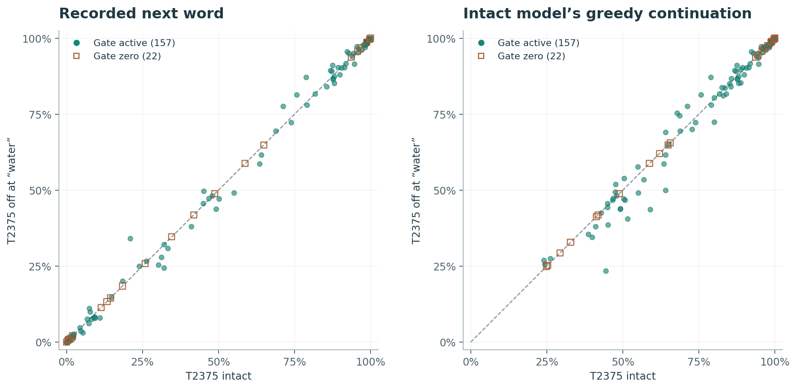

# Does removing T2375 at “water” change the next word?

Paired Qwen3-4B runs on all 179 occurrences in the original noun-modifier card, spanning 141 conversations. Both runs receive the identical full chat prefix ending at the measured “water” token. The intact run uses Qwen’s native MLP. The off run subtracts T2375’s naturally gated low-rank contribution from the layer-29 MLP output at this one token. Subsequent positions use the resulting attention cache and proceed without further intervention.

Each point scores the same token sequence under both conditions. The first panel scores the recorded continuation through the end of its first word; the second chooses that continuation by greedy decoding from the intact model. Where punctuation precedes the word, the score includes those punctuation tokens. A score multiplies the conditional probabilities of the tokens in that path. It ends at the word’s last token; it does not include the probability of a later word boundary or sum alternate tokenizations. The CSV also supplies the immediate next-token version of each comparison.

| Target | Mean intact probability | Mean off probability | Off minus intact, pp | 95% interval, pp |
|---|---:|---:|---:|---:|
| Recorded continuation | 65.90% | 65.86% | -0.04 | -0.32 to +0.26 |
| Intact model’s greedy continuation | 83.75% | 83.35% | -0.40 | -0.88 to +0.04 |

Intervals are paired percentile bootstraps over 141 whole conversations with 10,000 draws. The 22 native-zero gates reproduced identical probabilities. Among the 157 firing cases, the mean change for the recorded word was −0.046 percentage points. In 40 of the 179 cases the absolute change for the recorded continuation was at least one percentage point.

Five greedy predictions changed. In 3 of these a BF16 next-token logit tie occurred in at least one condition. In case 885, after “Sydney’s water”, the intact favorite “management” fell from 44.44% to 23.40%; the recorded word “supply” rose from 20.99% to 34.05% and became the off favorite.

Four frozen labels involve coordination (785, 787, 934, 973). The recorded next word in these positions is “and” or “or”. After excluding those cases, the mean change for the recorded continuation was −0.016 percentage points (95% interval −0.305 to +0.295). Seventeen recorded and 18 greedy target sequences contain multiple tokens. The results describe a local subtraction using the learned MOLT decomposition, with sensitivity to bfloat16 precision and the contexts drawn.

- [Per-case results](cases.csv) and [group estimates](summary.json)
- [Zoomable vector figure](scatter.svg)
- [Full records with token IDs](paired.json) and [verification hashes](verification.json)
- [Preparation, intervention and plotting code](../../experiments/water-modifier-ablation-20261121/)
