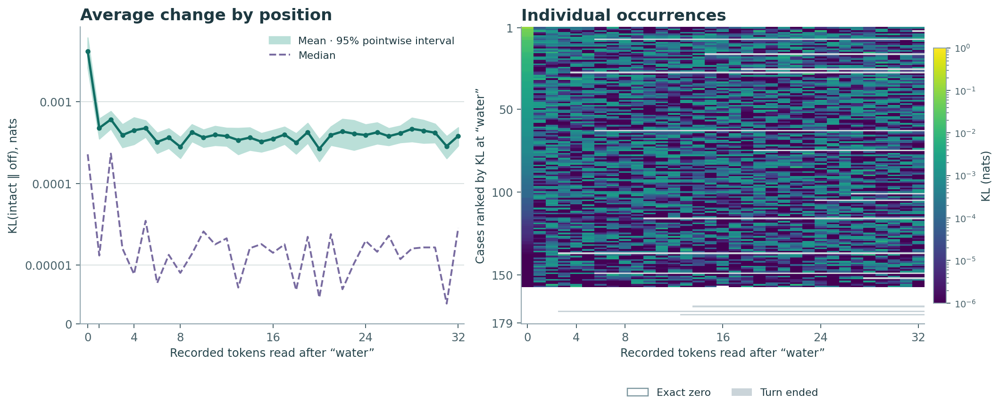

# T2375 ablation and next-token KL after “water”

The largest mean change occurred immediately, with mean KL 0.00416 nats at offset 0 and median 0.000227. The largest mean over the following positions was 0.000608 nats at +2. The immediate mean is 6.8 times that later mean. The immediate mean total variation was 1.68%, the fraction of probability mass redistributed on average.

| Offset after “water” | Cases | Mean KL (nats) | 95% interval | Median KL | Mean total variation |
|---:|---:|---:|---:|---:|---:|
| 0 | 179 | 0.004157 | 0.002604–0.006118 | 0.000227 | 1.68% |
| 1 | 179 | 0.000478 | 0.000352–0.000619 | 0.000013 | 0.68% |
| 2 | 179 | 0.000608 | 0.000468–0.000766 | 0.000232 | 0.89% |
| 4 | 176 | 0.000447 | 0.000301–0.000642 | 0.000008 | 0.61% |
| 8 | 173 | 0.000280 | 0.000203–0.000369 | 0.000009 | 0.44% |
| 16 | 169 | 0.000352 | 0.000266–0.000449 | 0.000014 | 0.56% |
| 32 | 163 | 0.000382 | 0.000290–0.000484 | 0.000028 | 0.59% |

## Measurement

The cohort comprises the same 179 frozen noun-modifier cases in 141 conversations. For each case the model received the original full chat prefix through “water”. The intervention subtracted the naturally gated L29–T2375 contribution only at that token. Both runs then received identical recorded continuations under causal attention, with their own resulting caches. At +1, for example, the model has read one additional token and is predicting the token after it. Windows stop before the next chat special token or after 32 following tokens. Four windows extend past the original 1,024-token sampling boundary to recover the recorded continuation.

Each measurement uses all 151,936 logit entries: sum over tokens of p × ln(p / q), where p is the intact probability and q the ablated probability. Model outputs are BF16, and log-softmax and KL arithmetic use FP64. The intervals resample whole conversations 10,000 times and are pointwise. Case order in the heatmap uses immediate KL. 47 of the 157 firing cases reached their largest observed KL at “water”; the remaining cases each had up to 32 later opportunities to exceed it.

All 22 zero-gate controls produced bit-identical logits across both trajectories at every available offset. The immediate recorded-token probabilities and top-token IDs matched the earlier paired experiment. The 163 complete-window cases also showed an immediate peak (mean 0.00393 nats at offset 0). The downloadable summary includes active-only and strict-adjacency means, as well as counts of top-token changes.

- [Per-offset data](by-offset.csv) and [all paired measurements](per-case-offset.csv)
- [Full-size figure](kl-by-position.svg), [frozen protocol](protocol.json), and [verification](verification.json)
- [Preparation, model run and plotting code](../../experiments/water-modifier-kl-20261121/)
